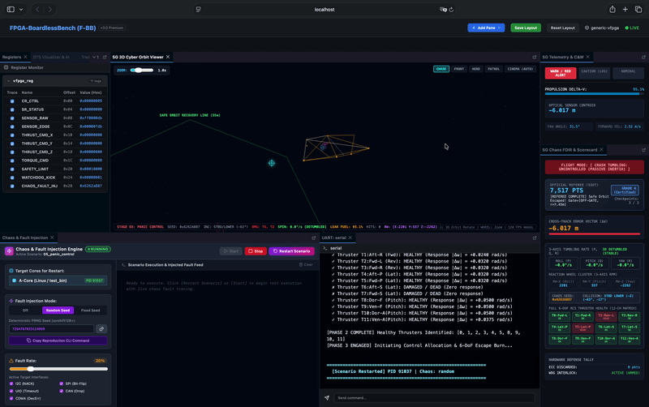
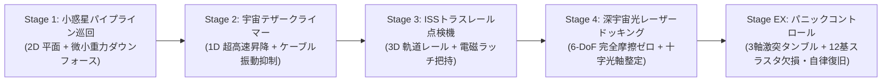
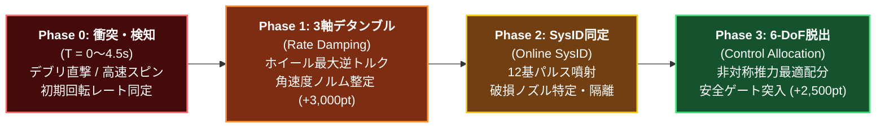
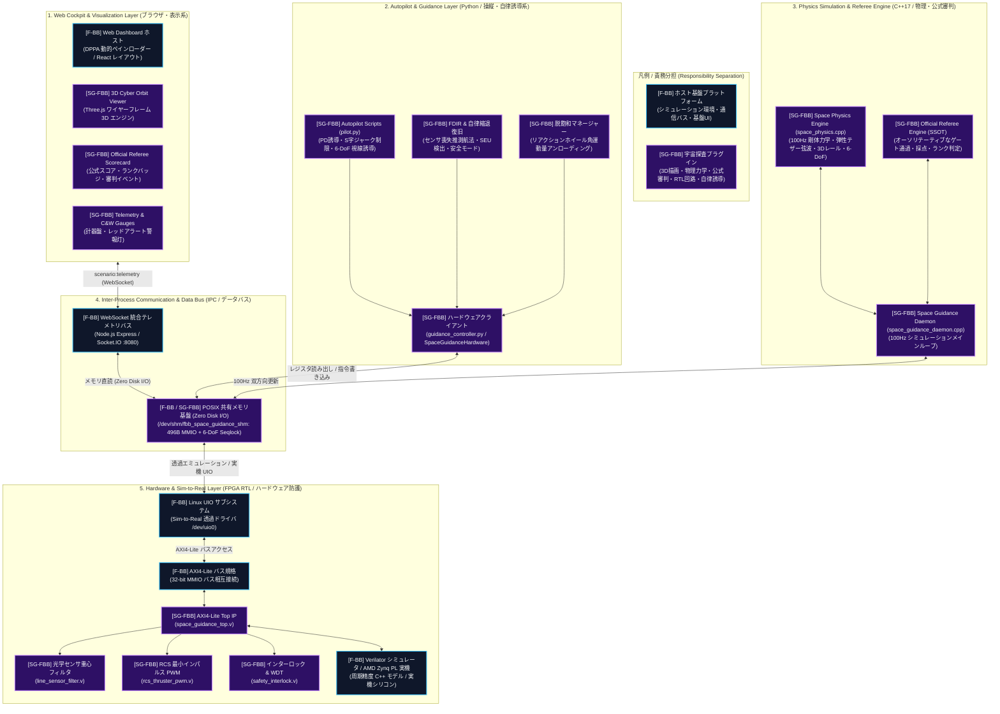
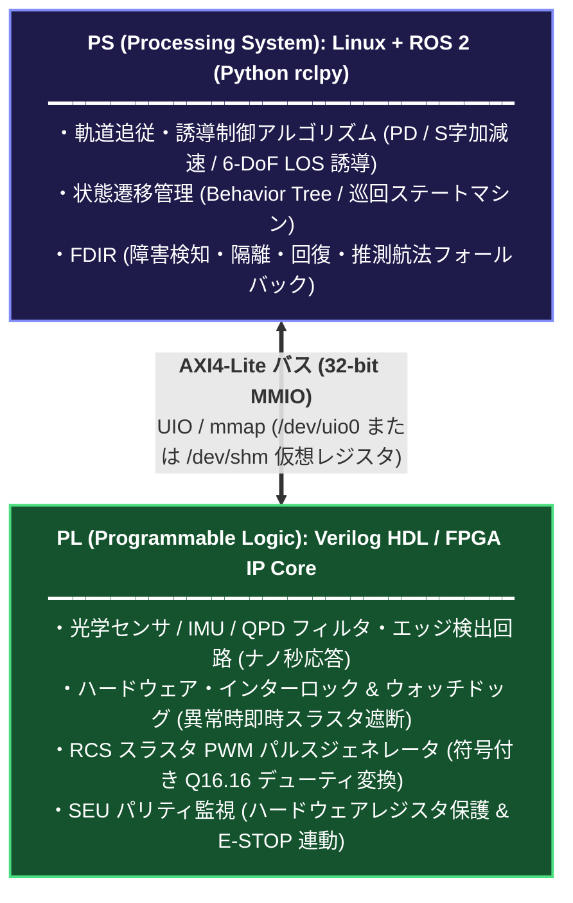
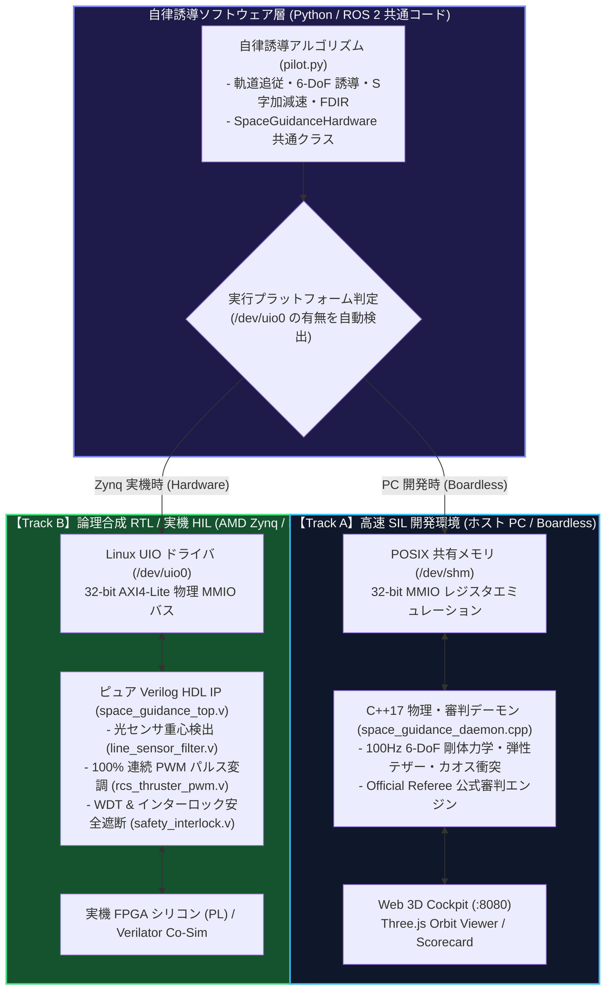
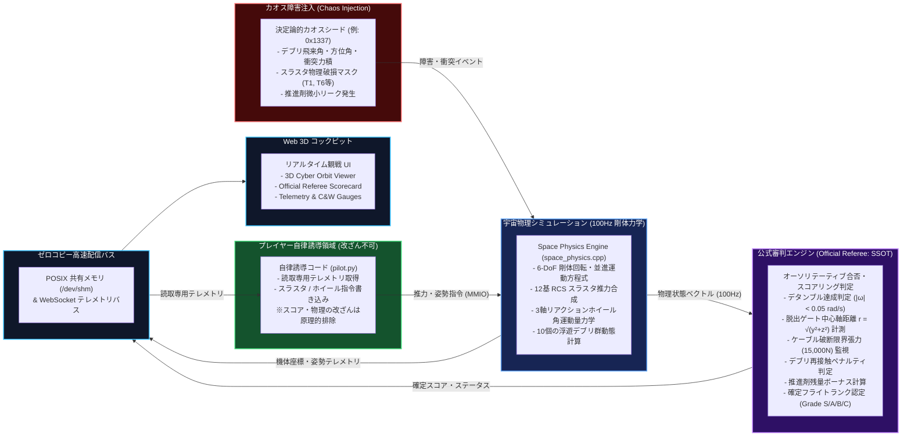

# SpaceGuidance-FBB: 自律宇宙探査・軌道ガイダンス プラグイン
(Autonomous Space Guidance & Docking Challenge Plugin for FPGA-BoardlessBench)


*▲ Stage 1: 小惑星パイプライン巡回 (2D微小重力ライン追従 & 光センサ重心検出回路)*


*▲ Stage EX (最新リリース): パニックコントロール (デブリ直撃による3軸高速タンブリング・スラスタ破損からの完全自律復旧)*

---

## 1. プロジェクト概要 (Project Overview)

**SpaceGuidance-FBB** は、組み込み教育・制御競技の原点である「ライントレースロボット」の制御概念を、極限環境である **「宇宙探査・軌道誘導（Space Guidance）」** へと昇華させた、FPGA-BoardlessBench (F-BB) 向けの完全独立型ゲームプラグインです。

> ### ☕ 作者からのメッセージ (Developer's Note)
> 
> 難しいことは抜きにして、まずはコーヒーを片手に動かしてみてほしいと思っています。「このパラメータを変えたら挙動が変わったな」とか、既存のサンプルをテキトーに変更して変化する挙動を楽しんでくれたら幸いです。
> 
> リアクションホイールやスラスターを一つだけ動かして機体がどんな挙動をするのかじっくり観察したり、メインスラスターを極限までふかして機体がどこまでスピードアップするのかみたり、極限までプログラム要素を削ぎ落として最小コードでどこまでステージをこなせるか挑戦してみたり（Stage 1 なんて得点を気にしないのであれば直進するだけでミッション達成できるんだから！）、残留するデブリに自らぶつかりに行って最低得点を狙うのだって楽しそうでしょ？
> 
> 楽しみ方は自由です。もちろん、本格的にゲームとしてやり込みたい人は、ここに書いてある技術情報を元にご自身の持てる工学知識をフル活用して高得点を狙うのも大いにありです！

従来の地上型ロボットが「車輪の機械的摩擦」と「目視リアルタイム操舵」に依存していたのに対し、本プラグインでは **「微小重力・完全無摩擦（Zero Friction）」の宇宙物理空間** を舞台とします。プレイヤーはゲームパッドでのアクション操作ではなく、**「FPGA RTL による超高速ハードウェア安全回路・PWM制御」** と **「Python (ROS 2 `rclpy`) による自律誘導アルゴリズム・FDIR（障害検知・隔離・回復）」** を設計・チューニングし、3Dサイバーワイヤーフレーム画面で宇宙探査機の自律航行を観戦・評価します。

---

## 2. 全5ステージ プログレッシブ・ロードマップ (Progressive Missions)

本プラグインは、基本となる「ハードウェア防護＋自律スラスタ制御」の共通アーキテクチャを土台としながら、物理次元と制御要素を段階的にステップアップできる **全5つのミッションステージ（基本4ステージ ＋ 最難関 Stage EX）** で構成されています。全5ステージとも物理エンジン・自律操縦スクリプト・公式審判システムが実装済みであり、即座にプレイ可能です。



| ステージ | ミッション名 | 難易度 | 物理環境と主要課題 | ハードウェア (RTL) | ソフトウェア (Python) | 専用ドキュメント |
| :--- | :--- | :---: | :--- | :--- | :--- | :---: |
| **Stage 1** | **小惑星パイプライン巡回**<br>(Asteroid Pipeline Inspector) | Level 1<br>(入門) | **2D微小重力・無摩擦**<br>小惑星表面50m S字誘導レール | 光センサ重心演算回路<br>(`line_sensor_filter.v`)、<br>ウォッチドッグ安全遮断 | PDライン追従誘導、<br>リアクションホイール脱飽和、<br>9ゲート通過航法 | [詳細ガイド](scenario/01_asteroid_pipeline/README.md) |
| **Stage 2** | **宇宙テザークライマー**<br>(Orbital Tether Climber) | Level 2<br>(初中級) | **1D直線運動＋弾性弦振動**<br>軌道エレベータ超長大テザー | 高速光学マークカウンタ、<br>共振周波数遮断ノッチフィルタ | ケーブル断裂防止 S字加減速、<br>共振抑制フィードフォワード | [詳細ガイド](scenario/02_tether_climber/README.md) |
| **Stage 3** | **ISSトラスレール点検機**<br>(ISS Truss Inspector) | Level 3<br>(中上級) | **3D立体曲面レール軌道**<br>急カーブ遠心力と反作用連成 | 3軸 IMU 慣性積分器、<br>電磁グリッパー把持力FBラッチ | 3次元レール曲率適応速度計画、<br>4箇所点検把持シーケンス | [詳細ガイド](scenario/03_iss_truss/README.md) |
| **Stage 4** | **深宇宙光レーザードッキング**<br>(Optical Laser Docking) | Level 4<br>(エキスパート) | **6-DoF 完全摩擦ゼロ**<br>初期360度ランダム方位、<br>遠心力自転ステーション同期 | 4分割フォトダイオード(QPD)光軸、<br>最小インパルス PWM RCS | 360度正対＆自転同期 FSM、<br>6自由度 LOS 光軸進入整定 | [詳細ガイド](scenario/04_laser_docking/README.md) |
| **Stage EX**<br>*(最新)* | **パニックコントロール**<br>(Panic Control: Debris Recovery) | Level 5<br>(最難関 / Extra) | **3軸高速タンブリング＋12基スラスタ欠損**<br>スペースデブリ直撃、角速度140°/s、燃料自然漏洩 | 12ch RCS パルス変調、<br>3軸リアクションホイール、<br>カオスインジェクション | 3軸レートダンピング(デタンブル)、<br>12基オンラインSysID(損傷同定)、<br>非対称推力配分 & 3D脱出 | [詳細ガイド](scenario/05_panic_control/README.md) |

### 2.1 最新リリース：Stage EX「パニックコントロール」自律復旧シーケンス

最新追加された **Stage EX (Panic Control)** では、漂流スペースデブリの激しい直撃を受け、探査機が毎秒140度超（$|\vec{\omega}_0| \approx 2.5\text{ rad/s}$）の激しい3軸高速カオスタンブリングに陥り、さらに搭載された12基のRCSスラスタのうち1〜2基が物理破損、燃料配管が損傷して微小リークが発生する極限状況からスタートします。

プレイヤーは手動介入なしに、自律スクリプト（`pilot.py`）のみで以下の **4大フェーズ** を完全自律で成し遂げなければなりません：



| フェーズ | 主要ミッション内容 | 制御アクチュエータ | 達成判定 / スコアボーナス |
| :--- | :--- | :--- | :--- |
| **Phase 0**<br>(0 〜 4.5s) | **衝突事態検知 & プロローグ**<br>・デブリ直撃による 3軸激突タンブル ($|\vec{\omega}| \approx 2.5\text{ rad/s}$)<br>・ノズル物理破損（1〜2基）＆燃料微小リーク発生 | なし（センサ同定期間） | センササンプリング & 初期姿勢同定 |
| **Phase 1** | **3軸緊急デタンブル (Rate Damping)**<br>・3軸リアクションホイール最大逆トルク制動（燃料消費ゼロ）<br>・健全 RCS スラスタによるレートダンピング逆噴射 | 3軸リアクションホイール<br>＋ 生存 RCS スラスタ | 全軸角速度ノルム $|\vec{\omega}| < 0.05\text{ rad/s}$ を 0.5s 保持<br>制動完了ボーナス (**+3,000 pts**) |
| **Phase 2** | **12ch オンライン同定 (Online SysID)**<br>・全12基のスラスタを順次 30ms 微小パルス噴射<br>・IMU 角加速度応答 $\Delta\omega$ の有無から破損ノズル特定 | 12基 RCS パルス噴射 | 破損ノズル自動隔離<br>健全スラスタ配列の確定 |
| **Phase 3** | **制御配分 & 6-DoF 安全圏脱出 (Control Allocation)**<br>・生存ノズルのみで不要トルク相殺しつつ $+X$ 前進推力を合成<br>・10個の浮遊デブリ群を回避しながら目標グリーンゲート突入 | 生存 RCS スラスタ統合配分<br>＋ リアクションホイール | 目標安全ゲート ($X \ge 35\text{m}$) 到達<br>脱出時中心軸精度ボーナス (最大 **+2,500 pts**) |

---

## 3. アーキテクチャと Sim-to-Real (Zynq-7000 / Kria 適合性)

### 技術スタック・責務分担アーキテクチャ全体図 (Full Technology Stack)

SpaceGuidance-FBB では、ベースプラットフォームである **FPGA-BoardlessBench (F-BB)** の基盤機能と、競技プラグインである **SpaceGuidance-FBB (SG-FBB)** の実装機能が明確に疎結合化されています。下図では、各コンポーネントの担当領域を目印（バッジ）および色分けで示しています。




本プラグインのハードウェア（PL論理）およびソフトウェア（PS CPU）のフットプリントは、AMD Xilinx Zynq-7000 (Z-7010 / Zybo, Cora) や Kria KV260 実機において、**1行のコード変更もなしにそのまま動作する設計（100% Sim-to-Real 透明性）** を保証しています。



### 3.1 Sim-to-Real 二層検証設計 (Dual-Track Validation Philosophy)
本プロジェクトは、航空宇宙・組込み制御分野で標準的な **MIL/SIL（ソフトウェア検証）と HIL/実機（ハードウェア論理合成）の階層分離** に基づき、目的の異なる 2 つの具象化トラック（Dual-Track）を並行して維持しています：



1. **Track A: 高速 SIL（Software-in-the-Loop）リアルタイム開発環境**
   * **実装**: C++ 物理シミュレーションデーモン（`space_guidance_daemon.cpp` / `space_physics.cpp`）
   * **役割**: ホスト PC 上で 100Hz の 6 自由度剛体力学演算、外乱・カオス障害、および Web3D ダッシュボードへのリアルタイム配信を、実機 FPGA なし（Boardless）で軽快に成立させます。
   * **価値**: 開発者は EDA ツールの重厚なクロック遅延シミュレーションに待たされることなく、自律航行アルゴリズムや FDIR の試行錯誤・反復学習を瞬時に行えます。
2. **Track B: 論理合成対応 RTL IP コア（Synthesizable Hardware & Verilator Co-Sim）**
   * **実装**: ピュア Verilog HDL（`rtl/space_guidance_top.v`, `line_sensor_filter.v`, `rcs_thruster_pwm.v`, `safety_interlock.v`）
   * **役割**: AMD Xilinx Vivado で論理合成（Synthesis）し、Zynq / Kria KV260 の実機 FPGA ファブリック（PL）にそのまま書き込み可能なハードウェア IP です。
   * **高信頼性安全アーキテクチャ**:
     * **真の 100% PWM 連続出力**: カウンタ飽和判定により 255/256（99.61%）のドロップアウトを排除し、最大指令時の正真正銘 100.00% 連続全開噴射（Continuous Full Burn）を担保。
     * **多軸双方向符号付き安全リミッター**: X軸推進力・Y軸ラテラル推力の両チャンネルに対し、符号を維持したまま設定限界値への厳格なクランプを実施（トップ階層テストポートで実測検証）。
     * **動的パリティ書き込みストローブ**: CPU による AXI レジスタ正常更新と、放射線等による自発的ビット反転（SEU）を正確に識別する動的奇数パリティ監視。
   * **包括的自動テスト体系**:
     * `tests/test_rtl_top.cpp`: 全 7 項目の RTL 単体テスト（真の 100% PWM 連続性、X/Y 軸のビットレベル合否アサート、SEU 動的保護、WDT タイムアウト）。
     * `tests/test_physics_sim.cpp`: 無摩擦慣性航行、センサ ADC エッジ検出、および「光学センサ ADC $	o$ RTL 重心演算 $	o$ PWM スラスタ噴射 $	o$ 6 自由度剛体物理推進」のクローズドループ Co-Sim 統合検証を自動アサートで 100% 保証。
3. **100% Sim-to-Real 透過性の保証 (Single Source of Truth)**
   * Track A（PC 上の SIL）で開発した自律操縦スクリプト（`pilot.py`）は、実機 FPGA（Track B）に移植した際も、`/dev/uio0` の 32-bit MMIO レジスタマップ仕様が完全に一致しているため、**1 行のコード変更もなしにそのまま実機で動作**します。

### 3.2 公式審判システム (Official Referee: Single Source of Truth)
本システムでは公平な競技性・シミュレーションの信頼性を担保するため、スコア計算・ゲート通過判定・ペナルティ判定・合否判定（Grade S/A/B/C）を各プレイヤーのスクリプトから完全に分離し、中央シミュレーションデーモン（`space_guidance_daemon.cpp`）内の **`OfficialReferee` エンジン** が 100Hz 周期でオーソリテーティブに判定します。



* **改ざん防止**: パイロットコード側の書き換えによるスコア偽装を原理的に排除。
* **高精度判定**: 100Hz の剛体力学ループ内でチェックポイント通過時の偏差や接触速度をミリ秒単位で正確に計測。
* **全方位配信**: 共有メモリ（SHM: 496バイト）および `/tmp/space_guidance_telemetry.json` を通じて Web ダッシュボードとパイロットへリアルタイム配信。

### 3.3 MMIO レジスタマップ仕様 (UIO 0x43C0_0000 / 共有メモリ 496バイト: 基本144B + 拡張352B)
| オフセット | レジスタ名 | 属性 | 説明 |
| :--- | :--- | :---: | :--- |
| `0x00` | `CR_CTRL` | R/W | システム制御（Bit 0: Enable, Bit 1: E-STOP, Bit 2: FDIR Reset, Bit 3: Engage） |
| `0x04` | `SR_STATUS` | R | ステータス（Bit 0: Active, Bit 1: Interlock, Bit 2: SEU Alert, Bit 3: LOS） |
| `0x08` | `SENSOR_RAW` | R | センサ受光強度 ADC 生データ（Stage 1: 8ch 光学 / Stage 4: QPD） |
| `0x0C` | `SENSOR_EDGE`| R | ハードウェア幾何重心偏差（符号付き Q16.16: -3.5〜+3.5 素子ピッチ単位、0.0が中心） |
| `0x10` | `THRUST_CMD_X` | R/W | X軸（メイン推進 / 登坂）推力指令値（Q16.16: -50N〜+50N） |
| `0x14` | `THRUST_CMD_Y` | R/W | Y軸（ラテラル横移動）推力指令値（Q16.16: -50N〜+50N） |
| `0x18` | `THRUST_CMD_Z` | R/W | Z軸推力指令値 / Stage EX: 12ch スラスタパルス噴射マスク（Q16.16 / Bitmask） |
| `0x1C` | `TORQUE_CMD` | R/W | RCS 姿勢回転トルク指令値（Q16.16: -20Nm〜+20Nm、Yaw軸） |
| `0x20` | `SAFETY_LIMIT` | R/W | ハードウェア最大推力・加速度リミッター設定値 |
| `0x24` | `WATCHDOG_KICK` | W | ハードウェア監視タイマークリア（100ms 未更新で自動安全遮断） |
| `0x28` | `CHAOS_FAULT_INJ` | R/W | F-BB カオス障害注入レジスタ（SEU, LOS, スラスタ固着, 衝突シード） |
| `0x2C` | `WHEEL_TORQUE_CMD` | R/W | リアクションホイール電気駆動トルク指令値（Q16.16: -20Nm〜+20Nm） |
| `0x30`〜`0x74` | `TELEMETRY_EXPORT` | R | 8バイト整列倍精度浮動小数点（`pos_x`, `pos_y`, `vel_x`, `vel_y`, `angle`, `omega`, `fuel`, `cross_track_err`, `wheel_rpm`） |
| `0x78` | `FDIR_MODE` | R/W | 現在のアクティブ FDIR 制御モード（0: NOMINAL, 1: DEGRADED, 2: SAFE, 3: ESCAPE） |
| `0x7C` | `STAGE_ID` | R | アクティブミッションステージ番号（1, 2, 3, 4, 5） |
| `0x80` | `OFFICIAL_SCORE` | R | 公式審判確定スコア（符号付き 32-bit int: 点数 pts） |
| `0x84` | `PASSED_GATES` | R | 通過済チェックポイント累積カウント |
| `0x88` | `MISSION_STATUS`| R | ミッション状態（0: ACTIVE, 1: COMPLETE, 2: FAILED） |
| `0x8C` | `TOTAL_GATES` | R | 当該ステージの総チェックポイント数 |
| `0x90` | `TORQUE_X` | R/W | 拡張 6-DoF: RCS ロールトルク指令（Q16.16: -20Nm〜+20Nm） |
| `0x94` | `TORQUE_Y` | R/W | 拡張 6-DoF: RCS ピッチトルク指令（Q16.16: -20Nm〜+20Nm） |
| `0x98` | `WHEEL_TORQUE_X` | R/W | 拡張 6-DoF: リアクションホイール X軸（ロール制動）トルク指令 |
| `0x9C` | `WHEEL_TORQUE_Y` | R/W | 拡張 6-DoF: リアクションホイール Y軸（ピッチ制動）トルク指令 |
| `0xA0` | `THRUST_VERTICAL`| R/W | 拡張 6-DoF: 垂直推力 Z コマンド（Q16.16: -50N〜+50N） |
| `0xA8` | `MAGIC_SPG1` | R | 6-DoF 拡張テレメトリ識別マジック（`0x53504731` 'SPG1'） |
| `0xAC` | `SEQ_NUM` | R | シーケンス番号（Seqlock 整合性検証用カウンタ） |
| `0xB0`〜`0x160` | `EXT_DOUBLES` | R | 6-DoF 姿勢・力学テレメトリ（`pos_z`, `vel_z`, `roll`, `pitch`, `yaw`, `omega_x,y,z`, `target_angle`, `target_omega`, `rel_angle`, `rel_omega` 等 計23項目） |
| `0x168`〜`0x18C`| `EXT_INTS` | R | 拡張スコア・健全性（`checkpoint_score`, `bonus_score`, `thruster_health`, `is_detumbled`, `chaos_seed` 等 計10項目） |
| `0x190`〜`0x1AF`| `OFFICIAL_GRADE` | R | 公式審判確定フライトランク文字列（ASCII 32B: `GRADE S` 等） |
| `0x1B0`〜`0x1EF`| `LAST_EVENT` | R | 最新審判イベント・判定メッセージ（ASCII 64B） |

---

## 4. クイックスタート (Quick Start)

SpaceGuidance-FBB は、F-BB（FPGA-BoardlessBench）の公式プラグイン規格（PPA 5.1 / DPPA v1.0）に準拠したハイブリッド拡張パッケージです。F-BB 統合 CLI（`fbb`）を用いてワンステップで導入・検証・起動できます。

### ① プラグインのインストール (Plugin Installation)
F-BB 環境のターミナルにて、以下の統合 CLI コマンドを実行してインストールします（自動的に `~/.fbb/plugins/SpaceGuidance-FBB` 配下へクローンされ、C++ 物理シミュレーションデーモンが自動コンパイルされます）：

```bash
# GitHub からワンショット導入（推奨）
fbb plugin install https://github.com/sirosiro/SpaceGuidance-FBB
```

導入後、プラグインの登録状況と仕様の健全性を確認します：
```bash
# 登録済みプラグイン一覧の確認（Hybrid: SpaceGuidance-FBB として検出）
fbb plugin list

# PPA / DPPA プラグイン仕様の整合性検証 (100% VALID チェック)
fbb plugin validate ~/.fbb/plugins/SpaceGuidance-FBB
```

### ② F-BB 統合ラボ環境での実行 (Web ダッシュボード・3D 観戦モード)
F-BB の Verilator RTL シミュレータ、C-Shim、および Web ダッシュボードと全連動させて実行します。

```bash
# Stage 1: 小惑星パイプライン巡回の起動
fbb lab ~/.fbb/plugins/SpaceGuidance-FBB/scenario/01_asteroid_pipeline

# Stage 2: 宇宙テザークライマーの起動
fbb lab ~/.fbb/plugins/SpaceGuidance-FBB/scenario/02_tether_climber

# Stage 3: ISS トラスレール点検機の起動
fbb lab ~/.fbb/plugins/SpaceGuidance-FBB/scenario/03_iss_truss

# Stage 4: 深宇宙光レーザードッキングの起動
fbb lab ~/.fbb/plugins/SpaceGuidance-FBB/scenario/04_laser_docking

# Stage EX: パニックコントロール（最新最難関・デブリ衝突自律復旧）の起動
fbb lab ~/.fbb/plugins/SpaceGuidance-FBB/scenario/05_panic_control
```

> **ローカル開発環境（`/workspaces` 等で直接作業している場合）**:
> 相対パスまたは直接パスを指定して起動することも可能です：
> ```bash
> ./start_lab.sh /workspaces/SpaceGuidance-FBB/scenario/05_panic_control
> ```

* **Web ダッシュボード**: ブラウザで [http://localhost:8080](http://localhost:8080) を開くと、以下の分割画面が自動ロードされます：
  * **SG 3D Cyber Orbit Viewer**: 立体ワイヤーフレーム飛行ビュー（自由視点回転、ズーム、カメラプリセット CHASE/FRONT/HERO/PATROL/TRACK/CINEMA）。Stage 1 の探査機、Stage 2 のピンチローラー式昇降ポッド＆GEOトーラスステーション＆小惑星基地、Stage 3 の立体トラス、Stage 4 の遠心力人工重力自転ステーション（ドッキングポート中心軸自転＆初期360度ランダム方位正対）、Stage EX のデブリ直撃ショックウェーブ＆12基スラスタ配置（破損ノズル赤色ブラケット）＆燃料蒸気リーク軌跡＆10個の浮遊デブリ群＆グリーン安全ゲートリングを完全3D描画。
  * **Official Referee Scorecard & Chaos FDIR**: リアルタイム公式スコア、確定フライトランク（Grade S/A/B/C）、チェックポイント通過進捗、審判イベントログを表示。カオス障害注入および `[Restart Scenario]` による即時再フライトが可能。
  * **SG Telemetry & C&W**: 推進剤残量バー、Master C&W 警報灯、姿勢角・速度計器。
  * **Registers & Tracer**: 全レジスタのリアルタイム16進数監視および時系列波形プロット。
  * **UART: serial**: 探査機がシリアル出力する航法テレメトリログ。

### ③ スタンドアローン直接実行 (CLI 高速モード)
Web ダッシュボードを介さず、コンソールのみで物理シミュレーションと自律航法スクリプトを高速実行する場合：

```bash
cd ~/.fbb/plugins/SpaceGuidance-FBB

# 各ステージの直接実行
bash scenario/01_asteroid_pipeline/run_mission.sh
bash scenario/02_tether_climber/run_mission.sh
bash scenario/03_iss_truss/run_mission.sh
bash scenario/04_laser_docking/run_mission.sh
bash scenario/05_panic_control/run_mission.sh --seed 0x1337
```

---

## 5. ディレクトリ構成 (Structure)

```text
SpaceGuidance-FBB/
├── fbb-plugin.json               # PPA/DPPA ハイブリッドプラグインマニフェスト
├── CMakeLists.txt                # C++ ビルド定義
├── README.md                     # ポータル: プロジェクト総合ガイド（本ドキュメント）
├── rtl/                          # Verilog HDL ハードウェア回路
│   ├── space_guidance_top.v      # AXI4-Lite IP コアトップ
│   ├── line_sensor_filter.v      # Stage 1: 8ch 光学センサ重心検出回路
│   ├── rcs_thruster_pwm.v        # RCS パルス幅変調ジェネレータ
│   └── safety_interlock.v        # ウォッチドッグタイマ & 安全遮断
├── src/                          # C++ 物理シミュレータ & デーモン
│   ├── space_physics.cpp         # 剛体力学・弾性テザー・レール・6-DoF 力学エンジン
│   └── space_guidance_daemon.cpp # 100Hz 物理デーモン & 公式審判エンジン (OfficialReferee)
├── ros2/nodes/                   # Python ハードウェアドライバ
│   └── guidance_controller.py    # Sim-to-Real UIO クライアント (SpaceGuidanceHardware)
├── scenario/                     # ステージ別独立シナリオ
│   ├── 01_asteroid_pipeline/     # 【Stage 1】小惑星回廊シナリオ (稼働中)
│   ├── 02_tether_climber/        # 【Stage 2】宇宙テザークライマー (稼働中)
│   ├── 03_iss_truss/             # 【Stage 3】ISS トラス点検機 (稼働中)
│   ├── 04_laser_docking/         # 【Stage 4】深宇宙レーザードッキング (稼働中)
│   └── 05_panic_control/         # 【Stage EX】パニックコントロール・自律復旧 (最新稼働中)
├── examples/                     # 原本・リセット用お手本テンプレート
│   ├── mission01_baseline_pilot.py   # Stage 1 原本
│   ├── mission02_baseline_climber.py # Stage 2 原本
│   ├── mission03_baseline_truss.py   # Stage 3 原本
│   ├── mission04_baseline_docker.py  # Stage 4 原本
│   └── mission05_baseline_panic.py   # Stage EX 原本
└── panes/                        # DPPA Web ダッシュボード動的ペイン
    ├── sg-orbit-viewer/          # 3D サイバー・ワイヤーフレーム描画
    ├── sg-telemetry-gauge/       # テレメトリ＆C&W レッドアラート
    └── sg-chaos-fdir/            # 公式審判スコアカード＆カオス FDIR コンソール
```

---

## 6. ライセンス (License)

本プロジェクトは **MIT License** の下で公開されています。商用・非商用問わず、誰でも自由に改変・再配布・利用することが可能です。
