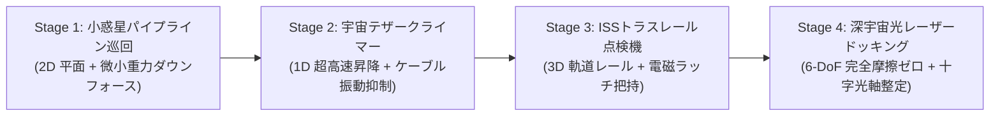

# SpaceGuidance-FBB: 自律宇宙探査・軌道ガイダンス プラグイン
(Autonomous Space Guidance & Docking Challenge Plugin for FPGA-BoardlessBench)

---

## 1. プロジェクト概要 (Project Overview)

**SpaceGuidance-FBB** は、組み込み教育・制御競技の原点である「ライントレースロボット」の制御概念を、極限環境である**「宇宙探査・軌道誘導（Space Guidance）」**へと昇華させた、FPGA-BoardlessBench (F-BB) 向けの完全独立型ゲームプラグインです。

従来の地上型ロボットが「車輪の機械的摩擦」と「目視リアルタイム操舵」に依存していたのに対し、本プラグインでは**「微小重力・完全無摩擦（Zero Friction）」の宇宙物理空間**を舞台とします。プレイヤーはゲームパッドでのアクション操作ではなく、**「FPGA RTL による超高速ハードウェア安全回路・PWM制御」** と **「Python (ROS 2 `rclpy`) による自律誘導アルゴリズム・FDIR（障害検知・隔離・回復）」** を設計・チューニングし、3Dサイバーワイヤーフレーム画面で宇宙探査機の自律航行を観戦・評価します。

---

## 2. 全4ステージ プログレッシブ・ロードマップ (Progressive Missions)

本プラグインは、基本となる「ハードウェア防護＋自律スラスタ制御」の共通アーキテクチャを土台としながら、物理次元と制御要素を段階的にステップアップできる **4つのミッションステージ** で構成されています。全4ステージとも物理エンジン・自律操縦スクリプト・公式審判システムが実装済みであり、即座にプレイ可能です。



| ステージ | ミッション名 | 難易度 | 物理環境と主要課題 | ハードウェア (RTL) | ソフトウェア (Python) | 専用ドキュメント |
| :--- | :--- | :---: | :--- | :--- | :--- | :---: |
| **Stage 1** | **小惑星パイプライン巡回**<br>(Asteroid Pipeline Inspector) | Level 1<br>(入門) | **2D微小重力・無摩擦**<br>小惑星表面50m S字誘導レール | 光センサ重心演算回路<br>(`line_sensor_filter.v`)、<br>ウォッチドッグ安全遮断 | PDライン追従誘導、<br>リアクションホイール脱飽和、<br>9ゲート通過航法 | [詳細ガイド](scenario/01_asteroid_pipeline/README.md) |
| **Stage 2** | **宇宙テザークライマー**<br>(Orbital Tether Climber) | Level 2<br>(初中級) | **1D直線運動＋弾性弦振動**<br>軌道エレベータ超長大テザー | 高速光学マークカウンタ、<br>共振周波数遮断ノッチフィルタ | ケーブル断裂防止 S字加減速、<br>共振抑制フィードフォワード | [詳細ガイド](scenario/02_tether_climber/README.md) |
| **Stage 3** | **ISSトラスレール点検機**<br>(ISS Truss Inspector) | Level 3<br>(中上級) | **3D立体曲面レール軌道**<br>急カーブ遠心力と反作用連成 | 3軸 IMU 慣性積分器、<br>電磁グリッパー把持力FBラッチ | 3次元レール曲率適応速度計画、<br>4箇所点検把持シーケンス | [詳細ガイド](scenario/03_iss_truss/README.md) |
| **Stage 4** | **深宇宙光レーザードッキング**<br>(Optical Laser Docking) | Level 4<br>(エキスパート) | **6-DoF 完全摩擦ゼロ**<br>オイラー運動方程式、デルタV制限 | 4分割フォトダイオード(QPD)光軸、<br>最小インパルス PWM RCS | 6自由度 Line-of-Sight 誘導、<br>7段階レンジ接近整定 | [詳細ガイド](scenario/04_laser_docking/README.md) |

---

## 3. アーキテクチャと Sim-to-Real (Zynq-7000 / Kria 適合性)

本プラグインのハードウェア（PL論理）およびソフトウェア（PS CPU）のフットプリントは、AMD Xilinx Zynq-7000 (Z-7010 / Zybo, Cora) や Kria KV260 実機において、**1行のコード変更もなしにそのまま動作する設計（100% Sim-to-Real 透明性）** を保証しています。

```
+-----------------------------------------------------------------------+
|  PS (Processing System): Linux + ROS 2 (Python rclpy)                 |
|  - 軌道追従・誘導制御アルゴリズム (PD / S字加減速 / 6-DoF LOS 誘導)    |
|  - 状態遷移管理 (Behavior Tree / 巡回ステートマシン)                  |
|  - FDIR (障害検知・隔離・回復・推測航法フォールバック)                |
+-----------------------------------------------------------------------+
                                   ||  UIO / mmap (/dev/uio0 or /tmp/vfpga_reg)
                                   \/  AXI4-Lite バス (32-bit MMIO)
+-----------------------------------------------------------------------+
|  PL (Programmable Logic): Verilog HDL / FPGA IP Core                  |
|  - 光学センサ / IMU / QPD フィルタ・エッジ検出回路 (ナノ秒応答)       |
|  - ハードウェア・インターロック & ウォッチドッグ (異常時即時スラスタ遮断)|
|  - RCS スラスタ PWM パルスジェネレータ (最小インパルス噴射制御)        |
|  - SEU パリティ監視 & TMR (Triple Modular Redundancy) レジスタ保護    |
+-----------------------------------------------------------------------+
```

### 公式審判システム (Official Referee: Single Source of Truth)
本システムでは公平な競技性・シミュレーションの信頼性を担保するため、スコア計算・ゲート通過判定・ペナルティ判定・合否判定（Grade S/A/B/C）を各プレイヤーのスクリプトから完全に分離し、中央シミュレーションデーモン（`space_guidance_daemon.cpp`）内の **`OfficialReferee` エンジン** が 100Hz 周期でオーソリテーティブに判定します。

* **改ざん防止**: パイロットコード側の書き換えによるスコア偽装を原理的に排除。
* **高精度判定**: 100Hz の剛体力学ループ内でチェックポイント通過時の偏差や接触速度をミリ秒単位で正確に計測。
* **全方位配信**: 共有メモリ（SHM: 144バイト）および `/tmp/space_guidance_telemetry.json` を通じて Web ダッシュボードとパイロットへリアルタイム配信。

### MMIO レジスタマップ仕様 (UIO 0x43C0_0000 / 共有メモリ 144バイト)
| オフセット | レジスタ名 | 属性 | 説明 |
| :--- | :--- | :---: | :--- |
| `0x00` | `CR_CTRL` | R/W | システム制御（Bit 0: Enable, Bit 1: E-STOP, Bit 2: FDIR Reset） |
| `0x04` | `SR_STATUS` | R | ステータス（Bit 0: Active, Bit 1: Interlock, Bit 2: SEU Alert, Bit 3: LOS） |
| `0x08` | `SENSOR_RAW` | R | センサ受光強度 ADC 生データ（Stage 1: 8ch 光学 / Stage 4: QPD） |
| `0x0C` | `SENSOR_EDGE`| R | ハードウェア検出重心変位（固定小数点 Q16.16: -1.0〜+1.0） |
| `0x10` | `THRUST_CMD_X` | R/W | X軸（メイン推進 / 登坂）推力指令値（Q16.16: -50N〜+50N） |
| `0x14` | `THRUST_CMD_Y` | R/W | Y軸（ラテラル横移動）推力指令値（Q16.16: -50N〜+50N） |
| `0x18` | `THRUST_CMD_Z` | R/W | Z軸推力指令値（Q16.16） |
| `0x1C` | `TORQUE_CMD` | R/W | RCS 姿勢回転トルク指令値（Q16.16: -20Nm〜+20Nm） |
| `0x20` | `SAFETY_LIMIT` | R/W | ハードウェア最大推力・加速度リミッター設定値 |
| `0x24` | `WATCHDOG_KICK` | W | ハードウェア監視タイマークリア（100ms 未更新で自動安全遮断） |
| `0x28` | `CHAOS_FAULT_INJ` | R/W | F-BB カオス障害注入レジスタ（SEU, LOS, スラスタ固着） |
| `0x2C` | `WHEEL_TORQUE_CMD` | R/W | リアクションホイール電気駆動トルク指令値（Q16.16: -20Nm〜+20Nm） |
| `0x30`〜`0x74` | `TELEMETRY_EXPORT` | R | 8バイト整列倍精度浮動小数点（`pos_x`, `pos_y`, `vel_x`, `vel_y`, `angle`, `omega`, `fuel`, `cross_track_err`, `wheel_rpm`） |
| `0x78` | `FDIR_MODE` | R/W | 現在のアクティブ FDIR 制御モード（0: NOMINAL, 1: DEGRADED, 2: SAFE） |
| `0x7C` | `STAGE_ID` | R | アクティブミッションステージ番号（1, 2, 3, 4） |
| `0x80` | `OFFICIAL_SCORE` | R | 公式審判確定スコア（符号付き 32-bit int: 点数 pts） |
| `0x84` | `PASSED_GATES` | R | 通過済チェックポイント累積カウント |
| `0x88` | `MISSION_STATUS`| R | ミッション状態（0: ACTIVE, 1: COMPLETE, 2: FAILED） |
| `0x8C` | `TOTAL_GATES` | R | 当該ステージの総チェックポイント数 |

---

## 4. クイックスタート (Quick Start)

### ① プラグイン仕様の検証 (PPA 整合性チェック)
```bash
cd /workspaces/FPGA-BoardlessBench
./bin/fbb plugin validate ~/.fbb/plugins/SpaceGuidance-FBB
```

### ② F-BB 統合ラボ環境での実行 (Web ダッシュボード・3D 観戦モード)
F-BB の Verilator RTL シミュレータ、C-Shim、および Web ダッシュボードと全連動させて実行します。

```bash
cd /workspaces/FPGA-BoardlessBench

# Stage 1: 小惑星パイプライン巡回の起動
./start_lab.sh /workspaces/SpaceGuidance-FBB/scenario/01_asteroid_pipeline

# Stage 2: 宇宙テザークライマーの起動
./start_lab.sh /workspaces/SpaceGuidance-FBB/scenario/02_tether_climber

# Stage 3: ISS トラスレール点検機の起動
./start_lab.sh /workspaces/SpaceGuidance-FBB/scenario/03_iss_truss

# Stage 4: 深宇宙光レーザードッキングの起動
./start_lab.sh /workspaces/SpaceGuidance-FBB/scenario/04_laser_docking
```

* **Web ダッシュボード**: ブラウザで [http://localhost:8080](http://localhost:8080) を開くと、以下の分割画面が自動ロードされます：
  * **SG 3D Cyber Orbit Viewer**: 立体ワイヤーフレーム飛行ビュー（自由視点回転、ズーム、カメラプリセット CHASE/FRONT/HERO/PATROL/CINEMA）。Stage 1 の探査機、Stage 2 のピンチローラー式昇降ポッド＆GEOトーラスステーション＆小惑星基地、Stage 3 の立体トラス、Stage 4 の自転ドッキングポートを完全3D描画。
  * **Official Referee Scorecard & Chaos FDIR**: リアルタイム公式スコア、確定フライトランク（Grade S/A/B/C）、チェックポイント通過進捗、審判イベントログを表示。カオス障害注入および `[Restart Scenario]` による即時再フライトが可能。
  * **SG Telemetry & C&W**: 推進剤残量バー、Master C&W 警報灯、姿勢角・速度計器。
  * **Registers & Tracer**: 全レジスタのリアルタイム16進数監視および時系列波形プロット。
  * **UART: serial**: 探査機がシリアル出力する航法テレメトリログ。

### ③ スタンドアローン直接実行 (CLI 高速モード)
```bash
cd /workspaces/SpaceGuidance-FBB
bash scenario/01_asteroid_pipeline/run_mission.sh
bash scenario/02_tether_climber/run_mission.sh
bash scenario/03_iss_truss/run_mission.sh
bash scenario/04_laser_docking/run_mission.sh
```

---

## 5. ディレクトリ構成 (Structure)

```text
SpaceGuidance-FBB/
├── fbb-plugin.json               # PPA/DPPA ハイブリッドプラグインマニフェスト
├── CMakeLists.txt                # C++ ビルド定義
├── README.md                     # ポータル: プロジェクト総合ガイド（本ドキュメント）
├── rtl/                          # Verilog HDL ハードウェア回路
│   ├── space_guidance_top.v      # AXI4-Lite IP コアトップ
│   ├── line_sensor_filter.v      # Stage 1: 8ch 光学センサ重心検出回路
│   ├── rcs_thruster_pwm.v        # RCS パルス幅変調ジェネレータ
│   └── safety_interlock.v        # ウォッチドッグタイマ & 安全遮断
├── src/                          # C++ 物理シミュレータ & デーモン
│   ├── space_physics.cpp         # 剛体力学・弾性テザー・レール・6-DoF 力学エンジン
│   └── space_guidance_daemon.cpp # 100Hz 物理デーモン & 公式審判エンジン (OfficialReferee)
├── ros2/nodes/                   # Python ハードウェアドライバ
│   └── guidance_controller.py    # Sim-to-Real UIO クライアント (SpaceGuidanceHardware)
├── scenario/                     # ステージ別独立シナリオ
│   ├── 01_asteroid_pipeline/     # 【Stage 1】小惑星回廊シナリオ (稼働中)
│   ├── 02_tether_climber/        # 【Stage 2】宇宙テザークライマー (稼働中)
│   ├── 03_iss_truss/             # 【Stage 3】ISS トラス点検機 (稼働中)
│   └── 04_laser_docking/         # 【Stage 4】深宇宙レーザードッキング (稼働中)
├── examples/                     # 原本・リセット用お手本テンプレート
│   ├── mission01_baseline_pilot.py   # Stage 1 原本
│   ├── mission02_baseline_climber.py # Stage 2 原本
│   ├── mission03_baseline_truss.py   # Stage 3 原本
│   └── mission04_baseline_docker.py  # Stage 4 原本
└── panes/                        # DPPA Web ダッシュボード動的ペイン
    ├── sg-orbit-viewer/          # 3D サイバー・ワイヤーフレーム描画
    ├── sg-telemetry-gauge/       # テレメトリ＆C&W レッドアラート
    └── sg-chaos-fdir/            # 公式審判スコアカード＆カオス FDIR コンソール
```

---

## 6. ライセンス (License)

本プロジェクトは **MIT License** の下で公開されています。商用・非商用問わず、誰でも自由に改変・再配布・利用することが可能です。
