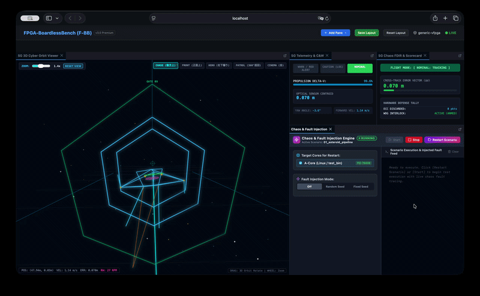

# SpaceGuidance-FBB

Autonomous Space Guidance and Docking Challenge Plugin for FPGA-BoardlessBench (F-BB).



---

## 1. 概要 (Overview)
`SpaceGuidance-FBB` は、組み込み教育・競技の定番である「ライントレースロボット」を、完全無摩擦・微小重力の「宇宙空間軌道誘導（Space Guidance）」へと昇華させた、F-BB 向けの完全独立型ゲームプラグインです。

* **プレイスタイル**: ゆったり観戦・チューニング型（ゲームパッドや激しいキー操作は不要）。
* **100% Sim-to-Real 透明性**: Verilog RTL（AXI4-Lite MMIO `0x43C00000`）および Python 制御スクリプトは、実機 AMD Xilinx Zynq-7000 (Z-7010) / Kria KV260 にそのまま移植・動作可能。
* **カオス障害注入 & FDIR**: 宇宙放射線 SEU、通信途絶（LOS）、太陽光センサ飽和などのトラブルに対し、ハードウェア保護回路と Python 自律リカバリー（推測航法・逆噴射ホバリング）で対抗。
* **DPPA 3D サイバー・ワイヤーフレーム**: 80年代ベクタースキャン風の軽量 3D 画面と、航空宇宙標準 C&W（Caution & Warning）アナンシエータ計器を搭載。

---

## 2. ディレクトリ構成 (Structure)
```text
SpaceGuidance-FBB/
├── fbb-plugin.json               # PPA/DPPA ハイブリッドプラグインマニフェスト
├── CMakeLists.txt                # C++ ビルド定義
├── README.md                     # 本ドキュメント
├── rtl/                          # Verilog HDL ハードウェア回路
│   ├── space_guidance_top.v      # AXI4-Lite スレーブ＆レジスタマップ (0x43C00000)
│   ├── line_sensor_filter.v      # 光学センサ ADC フィルタ＆Q16.16 重心計算
│   ├── rcs_thruster_pwm.v        # 8ch RCS スラスタ PWM パルス生成
│   └── safety_interlock.v        # ウォッチドッグ、SEU パリティ、E-STOP
├── src/                          # C++ シミュレーションデーモン
│   ├── space_guidance_daemon.cpp # 100Hz 物理・UIO 共有メモリブリッジ
│   └── space_physics.cpp         # 摩擦ゼロ・微小重力剛体物理エンジン
├── include/
│   └── space_physics.hpp         # 物理エンジンヘッダー
├── bin/
│   └── space_guidance_daemon     # 物理デーモン実行バイナリ
├── ros2/nodes/                   # Python ハードウェアドライバ
│   └── guidance_controller.py    # Sim-to-Real UIO/共有メモリ クライアント (SpaceGuidanceHardware)
├── scenario/
│   └── 01_asteroid_pipeline/     # 【Stage 1 小惑星回廊シナリオ】
│       ├── pilot.py              # ★【プレイヤー編集対象】自律オートパイロット制御スクリプト
│       ├── run.sh                # F-BB 統合ラボ起動スクリプト (start_lab.sh から呼出)
│       ├── run_mission.sh        # CLI 単体高速実行スクリプト
│       ├── test_chaos_fdir.py    # カオス障害自動検証テスト
│       ├── fbb_layout.json       # 3Dビューア＆ダッシュボード配置
│       └── main.c / CMakeLists.txt # F-BB 互換ビルドターゲット
├── examples/                     # お手本原本・リセット用テンプレート
│   └── mission01_baseline_pilot.py # 初期の基準お手本コード（復元用原本）
├── tests/                        # 自動検証・CIテストスイート
│   ├── test_stage1_run.py        # Stage 1 フルミッション結合テスト
│   ├── test_physics_sim.cpp      # 物理エンジン単体テスト
│   └── test_rtl_top.cpp          # Verilator RTL 回路単体テスト
├── docs/                         # アーキテクチャ図面・仕様資料
│   └── images/
│       └── spacecraft_hardware_layout.svg # 機体トポロジー配置図 (SVG)
├── assets/                       # デモ・ドキュメント用メディア
│   └── dashboard.gif             # ダッシュボードデモアニメーション
└── panes/                        # DPPA Web ダッシュボード動的ペイン
    ├── sg-orbit-viewer/          # 3D サイバー・ワイヤーフレーム描画
    ├── sg-telemetry-gauge/       # テレメトリ＆C&W レッドアラート
    └── sg-chaos-fdir/            # カオス FDIR コンソール＆スコアカード
```

---

---

## 3. 機体仕様・搭載ハードウェア (Spacecraft Hardware Specs)

本シナリオで運用される自律宇宙探査機は、実機 FPGA（AMD Xilinx Zynq-7000 / Kria KV260）への移植を前提とした本格的なハードウェア・センサ・アクチュエータ構成を備えています。物理シミュレーションは完全無摩擦・微小重力の真空中剛体として、100Hz（$\Delta t = 0.01\text{s}$）周期で運動方程式を数値積分しています。

### (1) 機体物理諸元 (Physical Properties)
* **乾燥質量 ($M$)**: $100.0\text{ kg}$（中型自律深宇宙探査機クラス）
* **ヨー軸慣性モーメント ($I_{zz}$)**: $25.0\text{ kg}\cdot\text{m}^2$
* **幾何学的回転半径 (Radius of Gyration)**: $r_g = \sqrt{I_{zz} / M} = \sqrt{25.0 / 100.0} = 0.50\text{ m}$
* **機体寸法**: 全長 $3.5\text{m}$（機首センサ端〜テールノズル後端）, 全幅 $3.6\text{m}$（翼端RCSポッド間）
* **力学環境**: 完全無摩擦・微小重力の深宇宙軌道空間（ニュートンの運動方程式に基づく慣性航行）

### (2) 推進・アクチュエータ系出力仕様 & 制御入力換算式 (Actuator Dynamics & Register Scaling)

探査機の推進制御レジスタ（MMIO）は、実機FPGA互換の 32-bit 符号付き Q16.16 固定小数点形式（$1.0 = \text{0x00010000} = 65,536$）を採用しています。Python や C 言語で制御器を設計する際は、正規化指令値 $u \in [-1.0, +1.0]$ を書き込むことで、物理エンジンが以下の実世界物理量へ換算して推進力・トルクを発生させます。

#### 機体推進系・センサ系トポロジー配置図 (Hardware & Thruster Architecture)


* **機体座標系 (Body Reference Frame)**:
  * **$+X$ 軸 (Forward / Heading)**: 機首方向。ロール軸。
  * **$+Y$ 軸 (Port / Left)**: 機体左舷方向。ピッチ軸。
  * **$+Z$ 軸 (Dorsal / Up)**: 機体天頂方向。ヨー軸（画面手前向き $\odot$）。

#### ① メイン推進スラスタ (Dual Aft Main Engines: `thrust_cmd_x`)
* **配置**: 機体尾部後端にツイン配置（`Nozzle L`, `Nozzle R`）。
* **レジスタ換算式**:
  $$F_x = \frac{\text{thrust\_cmd\_x}}{65,536} \times 50.0\text{ N} \quad (-50.0\text{ N} \le F_x \le +50.0\text{ N})$$
  * 正値（$+u_x$）: 前進加速（尾部メインノズルからプラズマ噴射）
  * 負値（$-u_x$）: 逆噴射制動（機首レトロスラスタから逆噴射）
* **最大並進加速度**:
  $$a_{x,\max} = \frac{F_{x,\max}}{M} = \frac{50.0\text{ N}}{100.0\text{ kg}} = 0.50\text{ m/s}^2$$
* **机上計算例（前進加速）**:
  静止状態（$v_x = 0$）から目標巡航速度 $v_x = 1.0\text{ m/s}$ まで全開加速（$u_x = 1.0$）した場合の所要時間と加速距離：
  $$t_{\text{acc}} = \frac{\Delta v_x}{a_x} = \frac{1.0\text{ m/s}}{0.50\text{ m/s}^2} = 2.0\text{ 秒}, \quad x_{\text{acc}} = \frac{1}{2} a_x t^2 = 1.0\text{ m}$$

#### ② ラテラル並進スラスタ (Lateral Translation RCS: `thrust_cmd_y`)
* **配置**: 機首・翼端の4箇所スラスタポッド。
* **レジスタ換算式**:
  $$F_y = \frac{\text{thrust\_cmd\_y}}{65,536} \times 50.0\text{ N} \quad (-50.0\text{ N} \le F_y \le +50.0\text{ N})$$
  * 正値（$+u_y$）: 左舷（$+Y$方向）並進加速
  * 負値（$-u_y$）: 右舷（$-Y$方向）並進加速
* **最大横加速度**:
  $$a_{y,\max} = \frac{F_{y,\max}}{M} = \frac{50.0\text{ N}}{100.0\text{ kg}} = 0.50\text{ m/s}^2$$

#### ③ RCS 姿勢制御スラスタ (Attitude RCS Thrusters: `torque_cmd`)
* **配置**: 翼端および機首の対向偶力ノズル群。
* **レジスタ換算式**:
  $$\tau_{\text{rcs}} = \frac{\text{torque\_cmd}}{65,536} \times 20.0\text{ N}\cdot\text{m} \quad (-20.0\text{ N}\cdot\text{m} \le \tau_{\text{rcs}} \le +20.0\text{ N}\cdot\text{m})$$
* **最大角加速度**:
  $$\alpha_{\text{rcs},\max} = \frac{\tau_{\text{rcs},\max}}{I_{zz}} = \frac{20.0\text{ N}\cdot\text{m}}{25.0\text{ kg}\cdot\text{m}^2} = 0.80\text{ rad/s}^2 \approx 45.84^\circ/\text{s}^2$$
* **机上計算例（バンバン姿勢変更）**:
  機体を $30^\circ$（$0.5236\text{ rad}$）旋回させる最短時間（最大トルクで加速→逆トルクで制動するバンバン制御）:
  $$t_{\text{half}} = \sqrt{\frac{\Delta\theta / 2}{\alpha}} = \sqrt{\frac{0.2618}{0.80}} \approx 0.572\text{ 秒} \implies t_{\text{total}} = 2 \times t_{\text{half}} \approx 1.14\text{ 秒}$$

#### ④ 内蔵リアクションホイール (Internal Reaction Wheel: `wheel_torque_cmd`)
* **配置**: 機体重心（CoM: $X=0.0\text{m}, Y=0.0\text{m}$）に同軸搭載された電動フライホイール。
* **推進剤消費ゼロ**: バッテリー電力のみで駆動し、燃料（Delta-V）を一切消費せずに精密な角運動量制御を実現。
* **ホイール物理特性**:
  * フライホイール慣性モーメント: $I_w = 0.02\text{ kg}\cdot\text{m}^2$
  * 定格・限界回転数: $\pm 6,000\text{ RPM} \implies \omega_{w,\max} = 6000 \times \frac{2\pi}{60} \approx 628.32\text{ rad/s}$
  * 最大蓄積角運動量 (Angular Momentum Capacity):
    $$H_{w,\max} = I_w \omega_{w,\max} = 0.02 \times 628.318 \approx 12.57\text{ N}\cdot\text{m}\cdot\text{s}$$
* **レジスタ換算と反作用トルク (Newton's 3rd Law)**:
  * ホイールモータートルク: $\tau_{\text{wheel}} = \frac{\text{wheel\_torque\_cmd}}{65,536} \times 20.0\text{ N}\cdot\text{m}$
  * フライホイール角加速度: $\dot{\omega}_w = \frac{\tau_{\text{wheel}}}{I_w}$
  * **機体本体に生じる反作用トルク**:
    $$\tau_{\text{body}} = -\tau_{\text{wheel}}$$
* **作用・反作用の角運動量保存則**:
  外乱トルクがない場合、機体本体とフライホイールの全角運動量は常に保存されます：
  $$I_{zz} \omega_{\text{body}} + I_w \omega_{\text{wheel}} = \text{const}$$
* **机上計算例（ホイール脱飽和・アンローディング所要時間）**:
  ホイールが $5,200\text{ RPM}$（$544.5\text{ rad/s}$）に達して脱飽和シーケンスを開始し、制動トルク $\tau_{\text{brake}} = 3.0\text{ N}\cdot\text{m}$（$u_w = 0.15$ 相当）を印加して安全回転数 $1,800\text{ RPM}$（$188.5\text{ rad/s}$）まで減速する所要時間：
  $$\Delta t_{\text{desat}} = \frac{I_w \Delta\omega_w}{\tau_{\text{brake}}} = \frac{0.02\text{ kg}\cdot\text{m}^2 \times (544.5 - 188.5)\text{ rad/s}}{3.0\text{ N}\cdot\text{m}} = \frac{7.12}{3.0} \approx 2.37\text{ 秒}$$

#### ⑤ 二刀流ハイブリッド姿勢制御 (Hybrid GNC Strategy)
* **通常航行**: リアクションホイールを優先駆動し、燃料消費ゼロで超高精度にラインへ追従。
* **ホイール脱飽和 (Momentum Desaturation / アンローディング)**: フライホイールが飽和限界（$5,200\text{ RPM}$ 超過）に達した際、RCSスラスタを一瞬噴射して機体姿勢を保持しながらホイール回転数を安全域（$1,800\text{ RPM}$ 以下）まで引き戻す宇宙工学シーケンスを実行。

#### ⑥ 推進剤（燃料）消費モデル (Propellant Consumption)
* **消費レート**:
  $$\frac{d(\text{Fuel})}{dt} = - \left( |F_x| + |F_y| + |\tau_{\text{rcs}}| \right) \times 0.0005 \quad [\%/\text{s}]$$
* **特性**:
  * メインスラスタおよび RCS スラスタの噴射力・トルクの大きさに比例して消費。
  * **リアクションホイール駆動時は $\tau_{\text{rcs}} = 0$ となり、推進剤消費は完全に $0.0\%/\text{s}$ を維持**（燃料節約ボーナスの最大化に直結）。

### (3) センサ系 (Sensors)
* **8ch 光学センサアレイバー (8-Channel Optical Line Sensor Array)**:
  * 機首前方 0.5m に搭載（4bit ADC × 8ch、各ch間隔 0.05m、全幅 0.35m）。
  * パイプライン中心線（再帰反射ガイドレール）の光度ピーク（ガウス分布）を検知。
  * **FPGA RTL重心演算回路 (`line_sensor_filter.v`)**: CPUを介さずハードウェア回路がナノ秒単位で幾何学的重心を計算し、中心からの偏差（`ADDR_SENSOR_EDGE`: `0x43C0000C`、Q16.16: -1.0〜+1.0）としてリアルタイム出力。
* **太陽光グレア飽和検知回路 (`line_sensor_filter.v`)**:
  * 直射日光照射による全センサ飽和（Glare Fault）を検知し、即時ステータス・割り込みを発行。
* **宇宙放射線 SEU モニタ & 通信断 (LOS) 監視回路 (`safety_interlock.v`)**:
  * 放射線によるレジスタパリティ異常（SEU）や、地上局との通信途絶（LOS: `sr_status & 0x08`）を常時監視。

### (4) 剛体運動方程式（シミュレーション数値積分モデル）
シミュレーションデーモン（[`src/space_physics.cpp`](file:///workspaces/SpaceGuidance-FBB/src/space_physics.cpp)）は、制御周期 $\Delta t = 0.01\text{s}$（100Hz）で以下の漸化式（半陰解法オイラー法）を解いて機体テレメトリを更新しています：

$$\begin{aligned}
\mathbf{a}_{\text{inertial}}(t) &= \frac{1}{M} \begin{pmatrix} \cos\theta(t) & -\sin\theta(t) \\ \sin\theta(t) & \cos\theta(t) \end{pmatrix} \begin{pmatrix} F_x(t) \\ F_y(t) \end{pmatrix} \\[6pt]
\mathbf{v}(t + \Delta t) &= \mathbf{v}(t) + \mathbf{a}_{\text{inertial}}(t) \Delta t \\[4pt]
\mathbf{p}(t + \Delta t) &= \mathbf{p}(t) + \mathbf{v}(t + \Delta t) \Delta t \\[6pt]
\tau_{\text{net}}(t) &= \tau_{\text{rcs}}(t) - \tau_{\text{wheel}}(t) \\[4pt]
\omega(t + \Delta t) &= \omega(t) + \frac{\tau_{\text{net}}(t)}{I_{zz}} \Delta t \\[4pt]
\theta(t + \Delta t) &= \theta(t) + \omega(t + \Delta t) \Delta t
\end{aligned}$$

### (5) 安全保護系 (Safety Interlocks)
* **ハードウェア・ウォッチドッグタイマ (`safety_interlock.v`)**:
  * CPU側プログラムのフリーズを検知し、定期キック（`ADDR_WATCHDOG_KICK`）が途絶えると自動的に推進系を遮断。
* **緊急停止 (E-STOP) ハードウェアインターロック**:
  * 異常検知時にスラスタPWM出力を物理的に遮断（フェイルセーフ）。

## 4. クイックスタート (Quick Start)

### ① プラグイン仕様の検証 (PPA 整合性チェック)
```bash
cd /workspaces/FPGA-BoardlessBench
./bin/fbb plugin validate ~/.fbb/plugins/SpaceGuidance-FBB
```

### ② F-BB 統合ラボ環境での実行 (Web ダッシュボード・3D 観戦モード)
F-BB の Verilator RTL シミュレータ、C-Shim、および Web ダッシュボードと全連動させて、リアルタイム 3D 空間で飛行を観戦・デバッグします。

```bash
cd /workspaces/FPGA-BoardlessBench
./start_lab.sh /workspaces/SpaceGuidance-FBB/scenario/01_asteroid_pipeline
```
* **Web ダッシュボード**: ブラウザで [http://localhost:8080](http://localhost:8080) を開くと、以下の 4 分割画面が自動ロードされます：
  * **SG 3D Cyber Orbit Viewer**: 3D 六角形ポータルトンネルをくぐり抜ける立体ワイヤーフレーム飛行ビュー。マウスドラッグによる自由視点回転、拡大縮小スライダー/ホイール操作、星々のダイナミック・スターフィールド（バンク角・視点連動パララックス）、カメラプリセット（`[CHASE]`後方上、`[FRONT]`正面上、`[HERO]`右下煽り、`[PATROL]`360°巡回）、および一定間隔で自動切り替わる `[CINEMA]` モードを搭載
  * **SG Telemetry & C&W**: 推進剤（燃料）残量バー、Master C&W 警報灯、姿勢角・速度計器
  * **SG Chaos FDIR & Scorecard**: 飛行モード遷移バナー、軌道偏差ベクトル（Δd）ゲージ
  * **Chaos & Fault Injection Engine**: F-BB 標準パネル。**`[Restart Scenario]`** ボタンから何度でもワンクリックで再フライト可能
* **終了方法**: ターミナルで `Ctrl + C` を押すと、全プロセスが安全に停止します。

### ③ スタンドアローン直接実行 (CLI 高速モード)
Web ダッシュボードを立ち上げず、物理デーモンと Python パイロットのみでアルゴリズムやパラメータ変更の結果を数秒で高速検証します。

```bash
cd /workspaces/SpaceGuidance-FBB
bash scenario/01_asteroid_pipeline/run_mission.sh
```

### ④ カオス障害注入・自律復旧 (FDIR) 自動検証
放射線 SEU（ビット反転）、通信途絶（LOS）、およびスラスター固着障害を自動注入し、機体の自己診断・推測航法復旧を CI テストします。

```bash
cd /workspaces/SpaceGuidance-FBB
python3 scenario/01_asteroid_pipeline/test_chaos_fdir.py
```

---

## 5. プレイヤーハッキングガイド (GNC Pilot Tuning Guide)

本ゲームの目的は、小惑星表面に設置された全長50mのガイドラインパイプラインに沿って探査機を自律航行させ、**全9箇所のチェックポイントゲートを高精度に通過して最高ランク「GRADE S」を獲得すること**です。

### (1) 編集対象ファイルとゲームプレイループ

* **プレイヤー編集対象ファイル**:
  ```text
  /workspaces/SpaceGuidance-FBB/scenario/01_asteroid_pipeline/pilot.py
  ```
* **即時反映のやり方 (Rapid Re-flight Loop)**:
  1. VS Code で [`scenario/01_asteroid_pipeline/pilot.py`](file:///workspaces/SpaceGuidance-FBB/scenario/01_asteroid_pipeline/pilot.py) を開きます。
  2. 後述の **TUNE ZONE 1〜3** のゲインや巡航速度を書き換えて保存（`Ctrl + S`）します。
  3. Webダッシュボード（`http://localhost:8080`）の **`Chaos & Fault Injection`** パネルにある **`[Restart Scenario]`** ボタンをクリックします（またはターミナルで `bash scenario/01_asteroid_pipeline/run_mission.sh` を再実行）。
  4. 新しいパラメータで即座に探査機が発進し、3Dビューアおよびコンソールでスコアの変化を確認できます！
* **初期状態へのリセット方法**:
  パラメータを弄りすぎて迷走してしまった場合は、`examples/` に保管されている原本からいつでもワンコマンドで復元できます：
  ```bash
  cp /workspaces/SpaceGuidance-FBB/examples/mission01_baseline_pilot.py /workspaces/SpaceGuidance-FBB/scenario/01_asteroid_pipeline/pilot.py
  ```

---

### (2) アーケード採点・評価システム (Scoring Rules)

ゴール到達時に以下の3つの要素から総合スコアが算出され、フライトランクが判定されます：

$$\text{Final Score} = \text{Total Gate Score} + \text{Fuel Bonus} + \text{Time Bonus}$$

| 評価項目 | 判定基準 | 獲得ポイント | 説明 |
| :--- | :--- | :--- | :--- |
| **ゲート通過精度**<br>(全9ゲート) | **PERFECT** (偏差 $\le 3\text{cm}$) | **$+1,000 \text{ pts}$** | ゲート中心をほぼピンポイントで通過 |
| | **GREAT** (偏差 $\le 12\text{cm}$) | **$+800 \text{ pts}$** | わずかなズレで良好に通過 |
| | **GOOD** (偏差 $\le 20\text{cm}$) | **$+500 \text{ pts}$** | ゲート枠内を安全に通過 |
| | **CLIP** (偏差 $\le 30\text{cm}$) | **$-300 \text{ pts}$** | ⚠️ ゲート枠に接触（減点ペナルティ） |
| | **MISS** (偏差 $> 30\text{cm}$) | **$0 \text{ pts}$** | ❌ ゲート通過失敗 |
| **残燃料ボーナス** | 残推進剤\% $\times 10$ | **最大 $+1,000 \text{ pts}$** | リアクションホイールを活用し燃料（RCS/メイン推力）を節約するほど加算 |
| **クリアタイムボーナス** | $50.0\text{s}$ 未満クリア | **$(50.0 - \text{Time}) \times 50 \text{ pts}$** | 巡航速度を高めて素早くゴールすると大幅加算 |

#### フライトランク基準
* **GRADE S**: **$8,000 \text{ pts}$ 以上**（極限の精密制御とハイスピード巡航、リアクションホイール完全活用が必須のマスターランク）
* **GRADE A**: **$6,500 \sim 7,999 \text{ pts}$**（ベースライン設定。ふらつきを抑えて全ゲートGOOD以上で完走）
* **GRADE B**: **$5,000 \sim 6,499 \text{ pts}$**
* **GRADE C**: **$5,000 \text{ pts}$ 未満**

---

### (3) 攻略用 3大チューニングゾーン (Tune Zones)

[`scenario/01_asteroid_pipeline/pilot.py`](file:///workspaces/SpaceGuidance-FBB/scenario/01_asteroid_pipeline/pilot.py) 内のコメント領域 `=== TUNE ZONE ===` を書き換えてハイスコアを狙いましょう：

#### 🎯 TUNE ZONE 1: 姿勢制御・ライン追従ゲイン (36〜41行目)
```python
# === TUNE ZONE 1: 制御ゲインのチューニング ===
kp = 0.90    # 旋回比例ゲイン (ラインからのズレに応じた回頭トルク)
kd = 0.15    # 旋回微分ゲイン (S字カーブ入口・出口でのふらつき・ハンチング抑制)
kw = 0.65    # ジャイロ角速度ダンピング (無摩擦空間特有の回りすぎを抑制)
klat = 0.80  # 横移動 RCS 追従ゲイン (ラインへの横並進補正)
kvlat = 0.60 # 横滑り速度ダンピング (横揺れの収束を早める)
```
* **攻略のヒント**:
  * `kd` をゼロのままにすると無重力空間特有の慣性で左右に激しく蛇行し、ゲートに接触します。`kd = 0.12 ~ 0.18` 程度に設定することでピタリと頭が定まります。
  * `kw` は角速度ダンピングです。過度に大きくすると旋回開始が重くなり、小さすぎるとスピンします。

#### 🚀 TUNE ZONE 2: 目標巡航速度 (44行目)
```python
# === TUNE ZONE 2: 巡航速度の設定 ===
target_vx = 1.2  # 目標巡航速度 (m/s)
```
* **攻略のヒント**:
  * 初期値の $1.2\text{ m/s}$ ではクリアタイムが約60秒となり、タイムボーナス（50秒未満）が付きません。
  * $target\_vx = 1.5 \sim 1.8\text{ m/s}$ へ引き上げることで40秒台前半でのクリアが可能になり、**タイムボーナス $+400 \sim +500 \text{ pts}$** が獲得できます。
  * ただし速度が上がると旋回加速度の限界によりS字カーブ外側へドリフトしやすくなるため、TUNE ZONE 1の `klat` や `kp` とのバランス調整が腕の見せ所です！

#### 🔋 TUNE ZONE 3: ハイブリッド制御 & リアクションホイール脱飽和 (171〜190行目)
```python
# ヒステリシス脱飽和シーケンス: 5200 RPM以上で脱飽和開始、1800 RPM以下で通常復帰
if in_desat:
    if abs(wheel_rpm) < 1800.0:
        in_desat = False
else:
    if abs(wheel_rpm) > 5200.0:
        in_desat = True
```
* **攻略のヒント**:
  * リアクションホイールは電気駆動のため**燃料消費ゼロ**です。通常時は姿勢制御を100%ホイールに任せることで、燃料残量ボーナス（$+990 \sim +1,000 \text{ pts}$）を最大化できます。
  * ホイール回転限界（$6,000\text{ RPM}$）に達するとモータートルクが飽和して姿勢を崩すため、飽和前に RCS スラスタでアンローディング（脱飽和）を行います。脱飽和時のブレーキトルク値（`wheel_brake`）を滑らかに調整することで、アンローディング中の姿勢乱れを防ぐことができます。

---

## 6. Zynq-7000 実機への移植ガイド (Sim-to-Real)
* **PL (FPGA 論理)**: `rtl/*.v` を Vivado IP Integrator に追加し、AXI4-Lite スレーブとして Zynq PS の M_AXI_GP0 (`0x43C00000`) に接続。
* **PS (ARM CPU)**: Linux 上で UIO ドライバ（`/dev/uio0`）をバインドし、`ros2/nodes/guidance_controller.py` をそのまま実行。

---

## ライセンス (License)

本プロジェクトは **MIT License** の下で公開されています。商用・非商用問わず、誰でも自由に改変・再配布・利用することが可能です。
