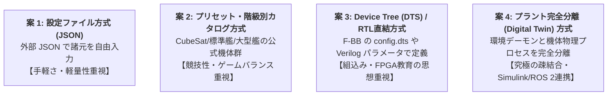

# Spacecraft Customization & Architecture Exploration
## (自作機体・自作RTL導入に向けた4つの設計アプローチ検討書)

- **文書作成日**: 2026-10-18
- **対象プラグイン**: `SpaceGuidance-FBB`

---

## 1. 検討の背景

SpaceGuidance-FBB（特に Stage EX: パニックコントロール）において、「学生が自作機体・自作RTLを準備して挑戦する」というユースケースを実現するため、機体諸元（質量・慣性モーメント・スラスタ配置・ホイール性能）と環境・審判の分離方式について、4つの設計可能性を比較検討した。

---

## 2. 4つの設計アプローチ比較

| 項目 | 案 1: JSON 設定ファイル | 案 2: 公式階級制プリセット | 案 3: Device Tree / RTL直結 | 案 4: プラント完全分離 (IPC) |
| :--- | :--- | :--- | :--- | :--- |
| **概要** | `spacecraft.json` に数値を記述しデーモンがロード | 3〜4種の公式バランス調整機体を切り替え | `config.dts` や Verilog パラメータで記述 | 物理計算自体を別プロセスへ外出し |
| **実装工数** | **小〜中 (約150行)** | **小〜中 (約150行 + 3Dモデル)** | **中 (DTS パース/レジスタ定義)** | **特大 (プロセス間同期・物理刷新)** |
| **教育的効果** | GNC（誘導制御）パラメータチューニング | 階級別コンペティション攻略 | Linux Device Tree / 組込みレジスタ実践 | フライトソフトウェア（FSW）実機結合 |
| **チート・破綻リスク** | 高（質量 0.001kg 等の入力が可能） | **極小（公式バランス維持）** | 小（DTS 仕様に準拠） | 中（学生側力学モデル依存） |
| **Web 3D 描画親和性** | 低（形状可変の描画が難しい） | **最高（機体専用 3D モデルを整備可）** | 低（形状可変の描画が難しい） | 低（形状可変の描画が難しい） |

---

## 3. 各アプローチの詳細

### 案 1: 設定ファイル方式（`spacecraft.json`）
- **詳細**:
  - `scenario/05_panic_control/spacecraft.json` に質量・慣性テンソル・スラスタ配列を外出し。
  - C++ デーモンを再コンパイルすることなく、JSON を書き換えるだけで手軽に機体チューニングが可能。
- **課題**:
  - 物理的に非現実的な設定値による演算発散や、スコア競技の公平性担保への対策が必要。

### 案 2: 公式プリセット・階級別カタログ方式（アーキタイプ制）
- **詳細**:
  - 競技・教育向けにバランス調整された公式機体を用意：
    1. **Standard Explorer（標準中型艦: 100kg / 12スラスタ）**: 現在のベースライン。
    2. **Agile CubeSat（超小型超高機動機: 15kg / 8スラスタ）**: 慣性が小さくスピンが猛烈だがホイール制動が機敏。
    3. **Heavy Cargo Shuttle（大型有人補給艦: 450kg / 16スラスタ）**: 慣性が巨大で制動に膨大な推力・燃料管理を要求。
    4. *(Custom)*: 自由記述 JSON も任意で許可。
- **魅力**:
  - 「CubeSat 部門」「重量艦部門」といった階級別リーダーボードが成立し、Web 3D 表示の完成度も最大化される。

### 案 3: Device Tree (DTS) / RTL パラメータ直結方式
- **詳細**:
  - `config.dts` や Verilog HDL のパラメータとして機体諸元を記述。
  - FPGA-BoardlessBench の本来の思想（Linux カーネル・Device Tree・MMIO 周辺回路）に最も忠実。

### 案 4: プラント完全分離（デジタルツイン方式）
- **詳細**:
  - 「デブリ飛来・衝突・審判を行う環境デーモン」と「運動方程式を解く機体プラント」を完全分離。
  - 機体の力学演算自体を学生が完全に自作（MATLAB/Simulink や ROS 2 から直接接続）できる究極の疎結合。
