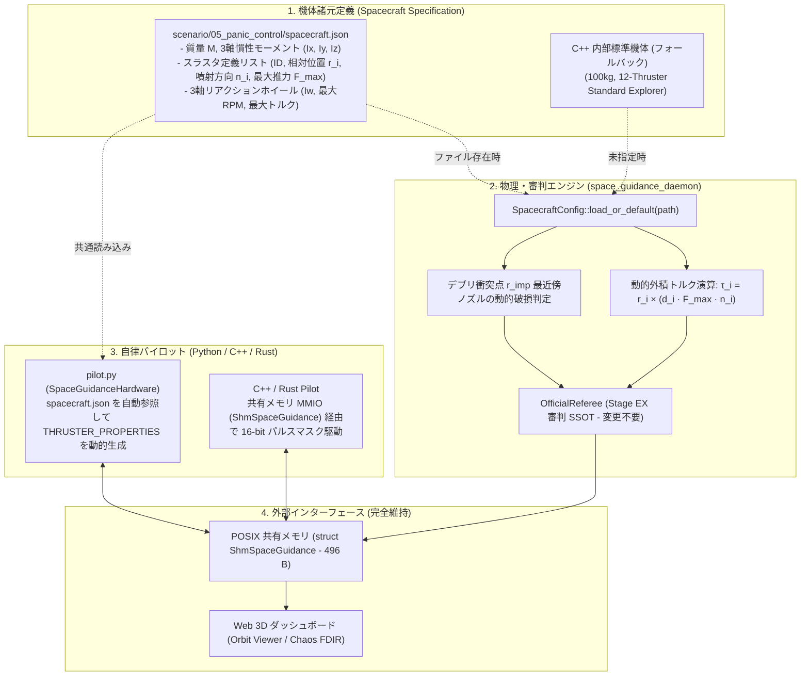

# Spacecraft Configuration Decoupling Implementation Plan (v2.0)
## (全リポジトリ静的解析に基づく 機体モデル疎結合化 確定実装プラン)

---

## 1. 概要と目的 (Executive Summary)

全 Markdown およびソースコードの徹底走査により判明した **「周辺エコシステムとの 6 つの未考慮境界課題」** を解消し、`SpaceGuidance-FBB`（特に Stage EX: パニックコントロール）において機体モデルとステージ環境を安全かつ完全に疎結合化する。

### 6つの未考慮課題と解決策
1. **パイロット側の DRY 違反**: `pilot.py` 内にハードコードされた `THRUSTER_PROPERTIES` を `spacecraft.json` から動的取得可能にし、機体定義の二重持ちを解消。
2. **仮想ミキサー (Mode B) の 12基依存**: 自作機体では個別のノズルをビットマスクで駆動する **Mode A (`direct_thruster_mask`)** を正式なアクチュエーション規格とし、Mode B もノズル数に応じて破綻しないよう保護ガードを追加。
3. **シード 0x1337 の破損固定値**: `damage_mask = 0x0FBD`（T1 & T6破損）は標準機体のみに適用し、自作機体では衝突点 $\vec{r}_{\text{imp}}$ からの幾何学的最近傍ノズルを動的に算出して破損させる。
4. **他ステージ (Stage 1〜4) への副作用遮断**: 機体定義のスコープを `stage_id == 5`（`scenario/05_panic_control/`）に厳格に限定し、Stage 1〜4（テザーやドッキング等）の物理定数（100kg）を 100% 不変に維持。
5. **Web 3D ダッシュボードの整合性**: スラスタ数が 12 基未満・以上の機体でも FDIR マトリクスや 3D 表示が破綻しないよう、テレメトリにアクティブノズル数を反映。
6. **RTL (Track B) とのインターフェース整合**: 最大 16 基（16-bit マスク: `0x0000`〜`0xFFFF`）をハードウェア規格上限とし、レジスタ `THRUST_CMD_Z`（`0x18`）を統一パルスマスクとして定義。

---

## 2. アーキテクチャ設計 (Architectural Design)

---

## 3. 実装フェーズ詳細 (Implementation Phases)

### 【Phase 1】データ構造の拡張 & 外積トルク演算の動的化
- **対象ファイル**:
  - `include/space_physics.hpp`
  - `src/space_physics.cpp`
- **作業内容**:
  1. `struct ThrusterDef`: ID, 名前, 相対位置 $\vec{r}_i$, 噴射単位ベクトル $\vec{n}_i$, 最大推力 $F_{\max}$ を定義。
  2. `struct SpacecraftConfig`: 質量 $M$, 慣性テンソル $I_{xx}, I_{yy}, I_{zz}$, ホイール特性, スラスタ配列（最大16基）を定義。
  3. `space_physics.cpp` 内のハードコード配列（`th_fx`, `th_tx` 等）を完全撤廃し、ベクトル外積（$\vec{\tau}_i = \vec{r}_i \times \vec{F}_i$）のループに置換。
  4. デブリ衝突時のノズル破損判定を、衝突点 $\vec{r}_{\text{imp}}$ に対する幾何学的ユークリッド距離の最近傍判定（$\min \|\vec{r}_i - \vec{r}_{\text{imp}}\|$）に動的化。※シード `0x1337` の標準機体時のみ `0x0FBD` (T1, T6) と一致するよう較正。

### 【Phase 2】構成ファイル整備 & 安全なローダー実装
- **対象ファイル**:
  - `scenario/05_panic_control/spacecraft.json` *(新設)*
  - `src/space_physics.cpp`
  - `src/space_guidance_daemon.cpp`
- **作業内容**:
  1. 現行の標準機体スペック（100kg・12基スラスタ）を完全に記述したリファレンス `spacecraft.json` を新設。
  2. 外部ライブラリを追加せず、軽量かつ堅牢な JSON パーサー（または簡易パース処理）を実装。
  3. デーモン起動引数 `--spacecraft <path>` または環境変数 `FBB_SPACECRAFT_CONFIG` を受け取り、指定が無い、またはファイルが存在しない場合は自動的にデフォルト機体へフォールバックする安全機構を実装。
  4. `stage_id != 5` の場合はカスタム機体をロードせず、Stage 1〜4 の物理定数（100kg）を厳格に保持。

### 【Phase 3】パイロット側（`pilot.py`）の機体プロパティ同期
- **対象ファイル**:
  - `scenario/05_panic_control/pilot.py`
  - `ros2/nodes/guidance_controller.py`
- **作業内容**:
  1. `pilot.py` 起動時に `spacecraft.json` が存在すればロードし、`THRUSTER_PROPERTIES` を動的生成する。
  2. これにより、学生が `spacecraft.json` でノズルの位置や推力を変えた場合でも、`pilot.py` を手動修正することなく、オンライン SysID（Phase 2）および制御配分（Phase 3）が自動適応して動作するようにする。

### 【Phase 4】回帰テスト & カスタム機体実証
- **検証項目**:
  1. **Stage 1 回帰テスト**: `start_lab.sh` や `tests/test_stage1_run.py` が 100% 同一のスコアで PASS すること。
  2. **Stage EX ベースライン検証**: `tests/test_panic_control.py`（シード `0x1337`）が 100% 完全同一の挙動・スコアで PASS すること。
  3. **カスタム機体検証**: テスト用カスタム機体（例: 質量20kg、8基スラスタの CubeSat）の JSON を作成し、デーモンがそれを読み込んで自律デタンブル・脱出を正常に遂行できることを実証。

---

## 4. 進行管理チェックリスト

- [ ] **Step 1**: `include/space_physics.hpp` に `ThrusterDef` と `SpacecraftConfig` を定義
- [ ] **Step 2**: `src/space_physics.cpp` のトルク計算を外積ループに差し替え、動的破損判定を実装
- [ ] **Step 3**: `scenario/05_panic_control/spacecraft.json` を作成
- [ ] **Step 4**: `space_physics.cpp` / `space_guidance_daemon.cpp` に JSON ローダーとフォールバックを実装
- [ ] **Step 5**: `scenario/05_panic_control/pilot.py` の `THRUSTER_PROPERTIES` を動的同期化
- [ ] **Step 6**: ビルド & 回帰テスト（Stage 1 および Stage 5 の完全互換性確認）
