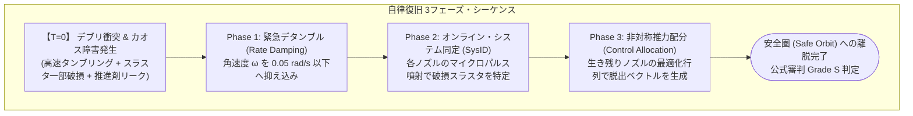
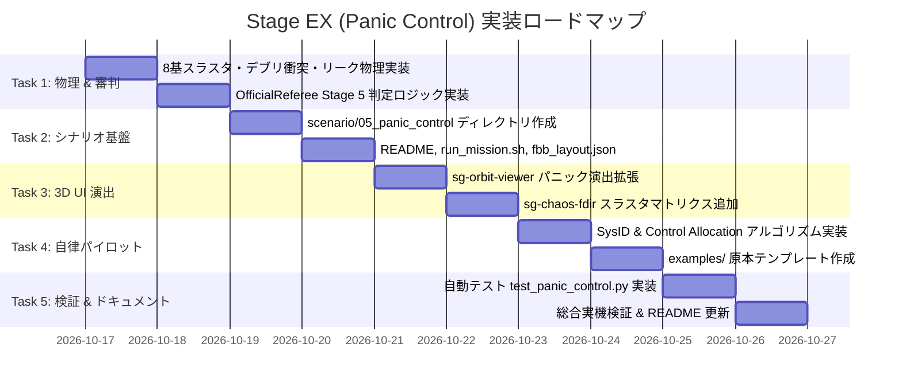

# SpaceGuidance-FBB: Stage EX (Panic Control: Debris Collision & Emergency Recovery) 実装計画書

- **文書バージョン**: 1.0.0
- **策定日**: 2026-10-16
- **ステータス**: 計画策定完了（承認待ち）
- **対象プラグイン**: `SpaceGuidance-FBB` (F-BB 側の変更: **一切不要 / 0行**)

---

## 1. 概要と背景 (Executive Summary & Background)

### 1.1 開発の目的
組み込み教育・制御競技プラグインである `SpaceGuidance-FBB` の集大成（Extra Stage）として、航空宇宙・制御工学の最高難度領域である **「パニックコントロール（Fault-Tolerant Control: 障害耐性制御）」** シナリオを実装する。

プレイヤーはジョイスティック等の手動操作を用いず、**完全自律の Python スクリプト（`pilot.py`）** のみを用いて、宇宙デブリ衝突による「高速タンブリング（激しいスピン）」「アクチュエータ一部破損（非対称化）」「推進剤リーク」という絶望的状況から機体の制御を取り戻し、安全圏への脱出を果たす。

### 1.2 コア設計思想との整合性
1. **100% プラグイン完結（F-BB 完全無改造）**:
   - F-BB ホスト側のコード変更を一切行わず、PPA（周辺回路プラグイン機構: ADR #005）および DPPA（動的ペイン機構）の枠組みの中だけで 100% 成立させる。
2. **100% ハードウェア透過性 (Sim-to-Real)**:
   - AXI4-Lite 32-bit MMIO バス規格（144バイト共有メモリ）をそのまま利用し、AMD Xilinx Zynq / Kria 実機環境でも無修正で走行可能とする。
3. **公式審判システム（Official Referee SSOT）の死守**:
   - デタンブル判定、破損判定、二次衝突、スコア計算はすべて C++ 中央デーモン側でオーソリテーティブに判定し、改ざんを原理的に排除する。

---

## 2. 物理環境・外乱モデル (Physics & Disturbance Modeling)



### 2.1 機体諸元
* **乾燥質量 ($M$)**: $100.0\text{ kg}$
* **ヨー軸慣性モーメント ($I_{zz}$)**: $25.0\text{ kg}\cdot\text{m}^2$
* **内蔵リアクションホイール ($I_w$)**: $0.02\text{ kg}\cdot\text{m}^2$（最大回転数 $\pm 6,000\text{ RPM}$、電気駆動・燃料消費ゼロ）

### 2.2 8基 RCS スラスタ・ジオメトリ (8-Thruster Topology)
機体周囲に配置された 8 基のパルス RCS スラスタ（各公称最大推力 $F_{\max} = 20.0\text{ N}$）：

```text
               +Y (Forward)
                 [T0]  [T1]        <- 機首ラテラル対向
             +----+------+----+
             |                |
   [-X] [T6] |     CoM (0,0)  | [T2] [+X]
   Left [T7] |   [Flywheel]   | [T3] Right
             |                |
             +----+------+----+
                 [T4]  [T5]        <- 尾部メイン推進 / 対向
               -Y (Aft)
```

| ノズル番号 | 取付位置 $\vec{r}_i = (x, y)$ | 噴射方向 $\vec{n}_i$ | 主な発生力 / トルク |
| :---: | :---: | :---: | :--- |
| **T0** | $(-0.8, +1.5)\text{ m}$ | $(+1, 0)$ [右向き] | $+F_x$ 横推力, 負トルク (時計回り) |
| **T1** | $(+0.8, +1.5)\text{ m}$ | $(-1, 0)$ [左向き] | $-F_x$ 横推力, 正トルク (反時計回り) |
| **T2** | $(+1.0, +0.5)\text{ m}$ | $(0, -1)$ [後向き] | $+F_y$ 前進推力, 負トルク |
| **T3** | $(+1.0, -0.5)\text{ m}$ | $(0, +1)$ [前向き] | $-F_y$ 後進推力, 正トルク |
| **T4** | $(-0.8, -1.5)\text{ m}$ | $(+1, 0)$ [右向き] | $+F_x$ 横推力, 正トルク |
| **T5** | $(+0.8, -1.5)\text{ m}$ | $(-1, 0)$ [左向き] | $-F_x$ 横推力, 負トルク |
| **T6** | $(-1.0, +0.5)\text{ m}$ | $(0, -1)$ [後向き] | $+F_y$ 前進推力, 正トルク |
| **T7** | $(-1.0, -0.5)\text{ m}$ | $(0, +1)$ [前向き] | $-F_y$ 後進推力, 負トルク |

### 2.3 デブリ衝突・カオス障害モデル
1. **衝突インパルス ($T=0$)**:
   - 瞬間角力積 $\Delta L = 37.5 \sim 75.0\text{ N}\cdot\text{m}\cdot\text{s}$ を注入。
   - 初期角速度 $\omega_0 = \Delta L / I_{zz} \approx 1.5 \sim 3.0\text{ rad/s}$ ($85^\circ/\text{s} \sim 172^\circ/\text{s}$ の激しいスピン)。
   - 瞬間並進力積により、ドリフト速度 $\Delta \vec{v} \approx (0.3 \sim 0.6)\text{ m/s}$ を付与。
2. **ランダム・スラスタ破損**:
   - 8 基中 **2〜3 基** の健全性フラグ $h_i$ を `0`（完全不発・推力ゼロ）に設定。
   - 決定論的テスト用のシード指定（例: `seed=42` で T1 と T6 が破損）をサポート。
3. **推進剤リーク**:
   - 燃料配管クラックにより、時間経過で自然流出：
     $$\dot{m}_{\text{leak}} = -0.15\text{ \%/s}$$
   - 約 50 秒放置で燃料が尽きるため、迅速な判断が必須。
4. **二次浮遊デブリ帯**:
   - 探査機初期位置を中心に、半径 $R = 30\text{ m}$ 内に 6〜8 個の浮遊デブリ（破片）を配置。
   - 接触半径 $r_{\text{hit}} \le 1.2\text{ m}$ で接触ペナルティ発動。

---

## 3. ハードウェア・MMIO・IPC レジスタ仕様

### 3.1 MMIO レジスタマップ（144バイト / Base: `0x43C00000`）
既存の SpaceGuidance レジスタ仕様に完全準拠し、未定義ビットを活用：

| オフセット | レジスタ名 | 属性 | Stage EX (Panic Control) での物理的意味 |
| :---: | :--- | :---: | :--- |
| `0x00` | `CR_CTRL` | R/W | Bit 0: Enable, Bit 1: E-STOP, Bit 2: FDIR Reset |
| `0x04` | `SR_STATUS` | RO | Bit 0: Active, Bit 1: Interlock, Bit 2: SEU Alert, Bit 3: Debris Collision Alert |
| `0x10` | `THRUST_CMD_X` | R/W | X軸推進力指令 (Q16.16) |
| `0x14` | `THRUST_CMD_Y` | R/W | Y軸推進力指令 (Q16.16) |
| `0x1C` | `TORQUE_CMD` | R/W | RCS 姿勢制御トルク指令 (Q16.16) |
| `0x24` | `WATCHDOG_KICK` | WO | WDT リセット（100ms 途絶で安全遮断） |
| `0x28` | `CHAOS_FAULT_INJ` | R/W | **Bit [7:0]**: スラスタ健全性マスク（`1`: 正常, `0`: 破損）<br/>**Bit 8**: IMU ノイズ注入<br/>**Bit 9**: 推進剤リーク有効化 |
| `0x2C` | `WHEEL_TORQUE_CMD` | R/W | リアクションホイール電気駆動トルク (Q16.16) |
| `0x30`〜`0x74`| `TELEMETRY_EXPORT`| RO | 倍精度浮動小数点（位置, 速度, 姿勢角, 角速度 $\omega$, 燃料, ホイールRPM） |
| `0x78` | `FDIR_MODE` | R/W | 現在のアクティブ制御モード（0: NOMINAL, 1: DETUMBLE, 2: SYS_ID, 3: ESCAPE） |
| `0x7C` | `STAGE_ID` | RO | **`5`** (Stage EX 固定) |
| `0x80` | `OFFICIAL_SCORE` | RO | 公式審判確定スコア (pts) |
| `0x88` | `MISSION_STATUS` | RO | 0: ACTIVE, 1: ESCAPED (SUCCESS), 2: FAILED (LEAK / COLLISION) |

### 3.2 テレメトリ JSON ストリーム (`/tmp/space_guidance_telemetry.json`)
```json
{
  "stage_id": 5,
  "stage_name": "Stage EX: Panic Control",
  "pos_x": 12.4,
  "pos_y": -4.2,
  "vel_x": 0.85,
  "vel_y": 0.12,
  "angle": 1.25,
  "omega": 0.03,
  "wheel_rpm": -4200.0,
  "fuel": 84.2,
  "tumbling_alert": false,
  "fdir_mode": 3,
  "fdir_mode_name": "ESCAPE_BURN",
  "thruster_health_mask": "0b11011011",
  "score": 6850,
  "detumble_time": 2.45,
  "debris_hits": 0,
  "mission_status": "ACTIVE",
  "official_grade": "IN_FLIGHT",
  "last_event": "[FDIR] Detumble Achieved in 2.45s! (+2265 pts)"
}
```

---

## 4. 自律操縦アルゴリズム設計 (Python `pilot.py`)

プレイヤーが実装・チューニングする `pilot.py` の制御フロー：

### Phase 1: 緊急デタンブル (Detumble)
* **目標**: 角速度 $|\omega|$ を $0.05\text{ rad/s}$ 未満に抑え込む。
* **制御則**:
  - リアクションホイールの全力逆トルク印加：
    $$\tau_{\text{wheel}} = - \text{sign}(\omega) \times \tau_{\max}$$
  - 推定ノズル群によるレートダンピング・パルス噴射：
    $$\tau_{\text{rcs}} = - K_d \cdot \omega$$

### Phase 2: オンライン・システム同定 (Online SysID)
* **目標**: どのノズルが破損しているかを $1.0\text{ 秒}$ 以内に自律同定する。
* **手法**:
  - 各ノズル $i \in \{0..7\}$ を微小時間（$\Delta t = 20\text{ms}$）単独パルス噴射。
  - IMU の角加速度応答 $\alpha_i = \Delta \omega / \Delta t$ を計測。
  - 応答 $|\alpha_i| < \epsilon_{\text{threshold}}$ のノズルを「破損（DEAD）」と判定し、制御効果行列 $B$ から除外。

### Phase 3: 制御配分 & 脱出バーン (Control Allocation & Escape)
* **目標**: 破損ノズルを除外した非対称スラスタ構成で、不要な回転トルクを相殺しながら安全圏脱出ベクトル（$+X$ 方向）へ加速。
* **最適化アルゴリズム**:
  - 制御効果行列 $B_{\text{effective}} \in \mathbb{R}^{2 \times m}$（$m \le 8$: 生き残りノズル数）：
    $$\begin{bmatrix} F_{\text{desired}} \\ \tau = 0 \end{bmatrix} = B_{\text{effective}} \mathbf{u}$$
  - 擬似逆行列（Moore-Penrose Pseudo-Inverse）または二次計画法（QP）により、各ノズルの噴射指令 $\mathbf{u} \in [0, 1]^m$ をリアルタイム算出。

---

## 5. 公式審判システム（SSOT）と採点基準

中央デーモン内の `OfficialReferee` エンジンが 100Hz 周期でオーソリテーティブに採点：

$$\text{Final Score} = \text{Base Clear (2,000)} + \text{Detumble Bonus} + \text{Fuel Bonus} + \text{Collision Free Bonus}$$

| 採点項目 | 計算式・条件 | 最大配点 | 備考 |
| :--- | :--- | :---: | :--- |
| **ベースクリア点** | 安全脱出ライン（$X \ge 35\text{m}$）到達 | **$+2,000\text{ pts}$** | 脱出成功時 |
| **デタンブル・スピード** | $\max(0, (10.0\text{s} - T_{\text{detumble}}) \times 300)$ | **$+3,000\text{ pts}$** | 3秒未満でスピン停止時ほぼ満点 |
| **推進剤残量ボーナス** | 残燃料 $(\%) \times 30.0$ | **$+3,000\text{ pts}$** | 最適推力配分で無駄な噴射を省くほど高得点 |
| **二次衝突ゼロボーナス** | 浮遊デブリへの再接触 $= 0$ 回 | **$+2,000\text{ pts}$** | 接触ごとに $-1,000\text{ pts}$ ペナルティ |

### フライトランク認定基準
* 🏆 **GRADE S**: **8,500 pts 以上**（超高速デタンブル、残燃料70%以上、デブリ完全回避）
* 🥇 **GRADE A**: 7,000 〜 8,499 pts
* 🥈 **GRADE B**: 5,000 〜 6,999 pts
* 🥉 **GRADE C**: 5,000 pts 未満（または燃料枯渇失格）

---

## 6. 3D Web コックピット演出設計 (Three.js & DPPA Panes)

1. **`sg-orbit-viewer` (3D サイバービューア)**:
   - **デブリ衝突演出**: シナリオ開始時の激しいカメラシェイク（振動減衰）、飛び散る衝突破片のワイヤーフレーム。
   - **高速回転星空**: 280 個の背景恒星がスピン角速度に合わせて高速ストリーク（流線）描画。
   - **ノズル別エフェクト**: 破損ノズルから赤色スパーク（火花）、健全ノズルからシアン色推進ガスパーティクル。
   - **二次デブリ警戒球**: 障害物デブリを赤色ワイヤーフレーム球体として周囲に描画。
2. **`sg-chaos-fdir` (公式スコアカード & FDIR パネル)**:
   - **TUMBLING RATE 警報**: 角速度に応じた動的アラート表示（赤色点滅）。
   - **スラスタ健全性マトリクス**: T0〜T7 のノズルヘルス（OK / DEAD / PULSING）をグラフィカル表示。
   - **フェーズ進行インジケータ**: `[DETUMBLE] -> [SYS_ID] -> [ESCAPE]`。
3. **`sg-telemetry-gauge` (計器盤)**:
   - 燃料リーク残量バー、3軸ジャイロ角速度インジケータ。

---

## 7. 実装タスク分解 (Work Breakdown Structure - WBS)



### [Task 1] 物理エンジン & 公式審判デーモンの拡張
- [ ] `SpaceGuidance-FBB/include/space_guidance_regs.h`
  - `STAGE_ID = 5` 定義、`CHAOS_FAULT_INJ` ビットフィールド定義、テレメトリ拡張。
- [ ] `SpaceGuidance-FBB/src/space_physics.cpp`
  - 8基独立スラスタ（位置・方向・健全性）の推力・トルク合成計算の実装。
  - 初期デブリ衝突インパルス（角速度スピン注入）および推進剤リーク計算の実装。
  - 周囲の二次浮遊デブリ群の生成と接触判定ルーチンの追加。
- [ ] `SpaceGuidance-FBB/src/space_guidance_daemon.cpp`
  - Stage 5 向け `OfficialReferee` 採点ステートマシン（デタンブルタイム、脱出判定、Grade認定）の実装。

### [Task 2] シナリオディレクトリ & 実行環境の構築
- [ ] `SpaceGuidance-FBB/scenario/05_panic_control/` の新設
  - `README.md`: ミッションブリーフィング、8基スラスタ仕様、攻略ガイドの作成。
  - `run_mission.sh`: スタンドアローン高速実行スクリプトの作成。
  - `fbb_layout.json`: ダッシュボード画面分割レイアウト定義の作成。
  - `CMakeLists.txt`: シナリオ固有ビルド定義（必要に応じて）。

### [Task 3] 3D サイバーコクピット & UI 演出の拡張
- [ ] `SpaceGuidance-FBB/panes/sg-orbit-viewer/index.js`
  - Stage 5 ロード時の衝突カメラシェイク、散乱デブリワイヤーフレーム描画。
  - 破損スラスタの赤色火花スパーク、生き残りノズルのガス噴射アニメーション。
- [ ] `SpaceGuidance-FBB/panes/sg-chaos-fdir/index.js`
  - スラスタ健全性マトリクス（T0〜T7 OK/DEAD インジケータ）の追加。
  - スピン警報（TUMBLING RATE: XX deg/s CRITICAL）およびフェーズ進行バーの追加。

### [Task 4] 自律復旧パイロット実装 & 原本作成
- [ ] `SpaceGuidance-FBB/scenario/05_panic_control/pilot.py`
  - Phase 1 (Detumble)、Phase 2 (SysID)、Phase 3 (Control Allocation) を備えたベースラインアルゴリズムの実装。
- [ ] `SpaceGuidance-FBB/examples/mission05_baseline_panic.py`
  - リセット用の原本スクリプトを配置。

### [Task 5] 包括的自動テスト & 検証
- [ ] `SpaceGuidance-FBB/tests/test_panic_control.py`
  - 初期スピンからのデタンブル成功、スラスタ同定正解率、脱出成功率を検証する自動テストスクリプト。
- [ ] スタンドアローンおよび F-BB 統合ラボ環境での動作検証（Grade S〜A 達成確認）。

### [Task 6] ドキュメント統合
- [ ] `SpaceGuidance-FBB/README.md` の更新（Stage EX の追加、全5ステージ構成へのロードマップ拡充）。

---

## 8. 成果物チェックリスト

- [x] 実装計画書（本ドキュメント: `docs/stage_ex_panic_control_plan.md`）
- [ ] 物理エンジン・審判デーモンバイナリ (`bin/space_guidance_daemon`)
- [ ] Stage EX シナリオ一式 (`scenario/05_panic_control/`)
- [ ] 3D Web ビューア & FDIR ペイン更新
- [ ] 自動テスト検証レポート (`tests/`)
