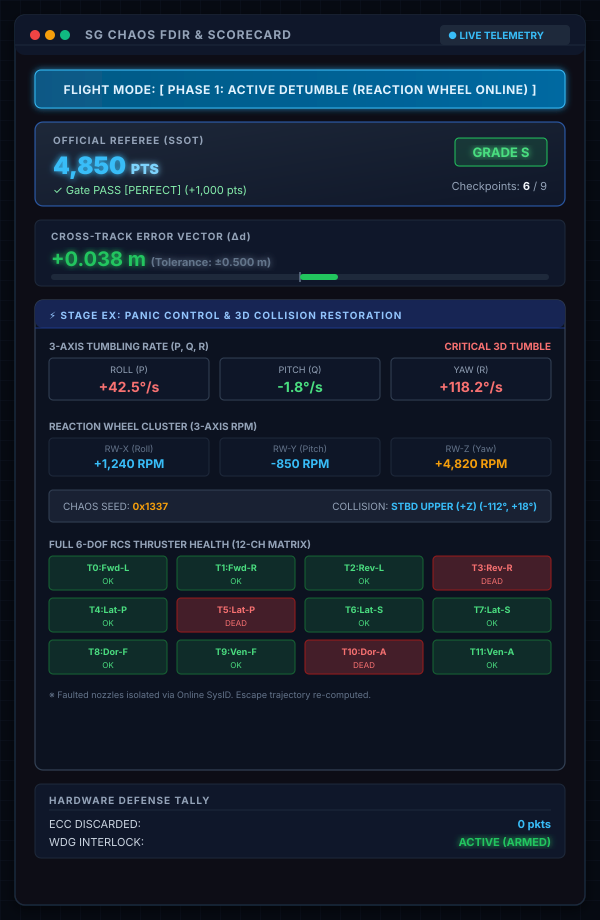
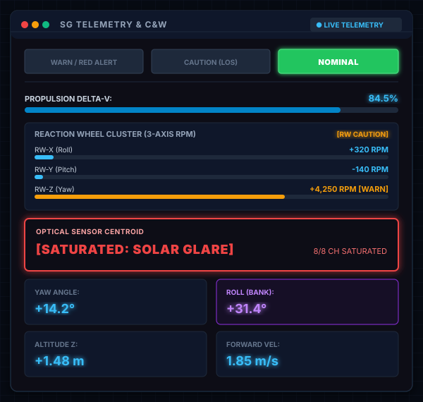

# SpaceGuidance DPPA Web ダッシュボード専用ペイン仕様書

本ドキュメントは、**SpaceGuidance-FBB** が F-BB の **DPPA (Dynamic Plugin Panel Architecture)** 機構を介して Web ダッシュボード（`http://localhost:8080`）に動的マウントする 3 つの専用フロントエンドペインの画面構成、インジケータ仕様、および内部動作ロジックを解説する技術仕様書です。

---

## 1. SG Chaos FDIR & Scorecard (公式審判 & 自律障害復旧モニター)

探査機の自律障害検知・回復（FDIR: Fault Detection, Isolation, and Recovery）状態遷移と、C++ 物理シミュレータ中央デーモン（`OfficialReferee` SSOT）による公式競技採点・ハードウェア健全性をリアルタイム監視する専用コンソールです。



### 画面構成要素と仕様詳細

#### (1) FDIR フライトモードバナー (Flight Mode Banner)
機体の自律航法ステータスを最上部にカラー太字バナーで表示します。
* **Stage 1〜4（パイプライン／クライマー／トラス／ドッキング）**:
  * `NOMINAL: TRACKING`（緑背景 `#065f46`）: 光学センサ追従による正常コース航行中。
  * `LOS: DEAD RECKONING`（黄褐背景 `#78350f`）: 太陽直射グレア等によるセンサ見失い（Line of Sight 喪失）。推測航法（Dead Reckoning）で直進維持。
  * `RECOVERY: STATION KEEPING`（青背景 `#075985`）: 深刻な姿勢乱れを検知し、緊急ステーションキーピング（姿勢制動）を発動中。
  * `RESTORED: NOMINAL ALIGNED`（濃緑背景 `#14532d`）: ガイドラインを再捕捉し、正常アライメントへ復帰完了。
* **Stage EX (5)（パニックコントロール・被弾復旧ミッション）**:
  * `CRASH TUMBLING: UNCONTROLLED`（深紅背景 `#7f1d1d`）: デブリ直撃直後の受動慣性タンブリング（激スピン）状態。
  * `PHASE 1: ACTIVE DETUMBLE`（青背景 `#075985`）: リアクションホイール最大トルクによる角運動量吸収・制振フェーズ。
  * `PHASE 2: ONLINE SYSID`（黄褐背景 `#78350f`）: スラスタを短パルス噴射して角加速度応答を観測し、被弾破損ノズルを自己同定・隔離するフェーズ。
  * `PHASE 3: ESCAPE BURN`（濃緑背景 `#14532d`）: 生存スラスタ群の推力再配分マトリクスを用いて、安全ゲートへの緊急脱出噴射を実行中。

#### (2) 公式審判スコアカード (Official Referee SSOT)
公平なアーケード競技性を担保するため、採点は機上 Python スクリプトではなく、C++ 物理シミュレータ（`space_guidance_daemon.cpp`）内の **`OfficialReferee` クラス** が 100Hz 周期でオーソリテーティブに判定します。
* **確定スコア (`PTS`)**: 獲得した現在の合計得点を 24px の特大フォントで表示。
  $$\text{Total Score} = \text{Checkpoint Score} + \text{Fuel Bonus} + \text{Time Bonus} - \text{Penalties}$$
* **直前イベントログ**: 直近に発生した審判判定をリアルタイム表示。
  * `Gate PASS [PERFECT] (+1,000 pts)`: ゲート中心からの誤差 $\le 5\text{cm}$ で通過。
  * `Gate PASS [GOOD] (+500 pts)`: 誤差 $\le 15\text{cm}$ で通過。
  * `CLIP [PENALTY] (-300 pts)`: ゲート開口枠（半径 $0.5\text{m}$）に接触。
* **公式フライトランク (Official Grade)**:
  * `GRADE S`（緑バッジ）: 8,000 pts 以上（ノーミス PERFECT & 高残燃料）。
  * `GRADE A`（青バッジ）: 6,000〜7,999 pts。
  * `GRADE B`（黄バッジ）: 4,000〜5,999 pts。
  * `GRADE C`（赤バッジ）: 4,000 pts 未満 または コースアウト失格。
* **チェックポイント通過進捗**: 全 9 ゲートの通過数（例: `Checkpoints: 6 / 9`）。

#### (3) 横方向偏差ベクトルゲージ (Cross-Track Error: $\Delta d$)
コース中心線からの機体重心ズレ（横偏差 $\Delta d$ [m]）を数値および伸縮バーで表示。
* **数値表示**: $\pm 0.100\text{m}$ 以内は安全な緑色、超過時は警戒のアンバー／赤色。
* **伸縮バー**: ゲート半径 $0.5\text{m}$（許容限界）に対する現在偏差の比率を直感的に可視化。

#### (4) パニックコントロール・被弾復旧ウィジェット（【Stage EX 専用】）
Stage EX 選択時に自動展開される 6-DoF 姿勢破壊・復旧診断パネルです。
* **3軸タンブリング角速度 (P, Q, R)**:
  * ロール（$P = \omega_x$）、ピッチ（$Q = \omega_y$）、ヨー（$R = \omega_z$）の各軸角速度（`°/s`）。
  * 3軸すべてが制振しきい値（$|\omega| < 0.05\text{ rad/s} \approx 2.86^\circ/\text{s}$）を満たすと `3D DETUMBLED (STABLE)`（緑色）へ遷移。
* **3軸リアクションホイール RPM (Reaction Wheel Cluster)**:
  * `RW-X (Roll)`, `RW-Y (Pitch)`, `RW-Z (Yaw)` の各フライホイール回転数。
* **カオス注入シード & デブリ衝突ベクトル**:
  * `CHAOS SEED`: 衝突物理乱数シード（例: `0x1337`）。
  * `COLLISION`: デブリの被弾方位（船首 BOW / 左舷 PORT / 右舷 STBD / 船尾 STERN）および被弾仰角（UPPER / LOWER / HORIZ）。
* **12ch 6-DoF RCS スラスタ健全性マトリクス (4×3 Grid)**:
  * 全 12 基のノズル（T0〜T11）の稼働健全性を色分け表示：
    * `OK`（緑背景 `#166534`）: 正常噴射可能。
    * `DEAD`（赤背景 `#991b1b`）: デブリ直撃により破壊・推力喪失。
  * プレイヤーは Online SysID により破損ノズル（`DEAD`）を特定・隔離し、残存ノズルのみで推力再配分制御を行います。

#### (5) ハードウェア防護集計 (Hardware Defense Tally)
* **`ECC DISCARDED`**: 宇宙放射線起因のメモリ化け・パケット破損を検知して破棄したパケット数。
* **`WDG INTERLOCK`**: 50Hz ハートビートが途絶えた際にハードウェア非常停止を発動するウォッチドッグ保護状態（`ACTIVE (ARMED)`）。

---

## 2. SG Telemetry & C&W (遠隔計測 & マスター警報アナンシエータ)

NASA の有人宇宙機コックピット計器規格にインスパイアされた、マスター警報盤（Caution & Warning）と燃料・推進・3次元姿勢角運動量をリアルタイム監視するフライト計器ペインです。



### 画面構成要素と仕様詳細

#### (1) 3色マスター C&W アナンシエータ (Master C&W Header)
宇宙機の致命的異常、運用警戒、正常運用を 3 つの独立ブロックで表示。
* **`WARN / RED ALERT` または `WARN / RW SAT`（赤色発光 `#ef4444`）**:
  * 太陽直射グレアによる全センサ飽和、横偏差致命的拡大（$> 0.4\text{m}$）、または**3軸いずれかのリアクションホイール限界回転数（$\ge 5,000\text{ RPM}$）到達による飽和警告**（スラスタによる角運動量アンローディングが必要）。
* **`CAUTION (LOS)`（黄色発光 `#f59e0b`）**:
  * コース見失い（Carrier Lost）、横偏差警戒域（$> 0.2\text{m}$）、または3軸ホイール警戒域（いずれかが $4,000 \sim 5,000\text{ RPM}$）。
* **`NOMINAL`（緑色発光 `#22c55e`）**:
  * 全センサ捕捉良好、姿勢偏差正常、アクチュエータ健全。

#### (2) 推進剤デルタV燃料計 (Propulsion Delta-V Bar)
* メイン推進スラスタおよび RCS 並進・姿勢噴射に伴う推進剤消費（$0.0 \sim 100.0\%$）をリアルタイム表示。
* **残量警告**: 残量 30% 以下でバーが青色から赤色へ反転。
* **スコア連携**: バッテリー駆動のリアクションホイール（燃料消費 0%）を活用して推進剤を温存することで、公式審判スコアカードの「残燃料ボーナス（最大 +1,000 pts）」を最大化できます。

#### (3) 3軸リアクションホイール・クラスタ角運動量計 (Reaction Wheel Cluster: 3-Axis RPM)
* 搭載されている全 3 軸（`RW-X: Roll`, `RW-Y: Pitch`, `RW-Z: Yaw`）のフライホイール角運動量を、3 連の独立したリアルタイムゲージバーで常時グラフィカル監視。
* **表示項目**:
  * 各軸の符号付き回転数（`±XXXX RPM`）と回転方向。
  * フライホイール定格限界（$6,000\text{ RPM}$）に対するリアルタイム伸縮バー。
  * ヘッダー部の一括ステータスバッジ（`[RW CAUTION]` / `[RW SATURATED]`）。
* **色分け基準**:
  * 通常域（$< 4,000\text{ RPM}$）: シアン `#38bdf8`
  * 警戒域（$4,000 \sim 5,000\text{ RPM}$）: アンバー `#f59e0b`
  * 飽和限界（$\ge 5,000\text{ RPM}$）: レッド `#ef4444` ＋ `[SAT]` バッジ
* 💡 **3軸全監視のメリット**: Stage 1 の Bank-to-Translate 旋回時の Roll 軸加速、Stage 3 の立体トラス登坂時の Pitch 軸補正、Stage EX の激スピン制振など、あらゆる 3 次元機動における姿勢制御余裕度をコックピットから一目で把握可能。

#### (4) 光学センサ重心 & 太陽光直射グレアインジケータ (Optical Sensor Centroid)
* 通常時は 8ch 光学センサアレイから得られたライン重心偏差（メートル）を表示。
* **太陽光直射グレア検知時**:
  * 8 素子すべてが直射光で飽和（`sensor_raw == 0xFFFFFFFF`）した瞬間に、表示が `[SATURATED: SOLAR GLARE]` へ切り替わります。
  * ペイン枠線が**深紅のパルス・ベゼル・グロー**（`box-shadow: 0 0 12px rgba(239, 68, 68, 0.6)`）で点滅発光し、パイロットに推測航法（Dead Reckoning）への緊急移行を促します。

#### (5) 探査機 3次元姿勢 & 飛行速度 2×2 グリッド
コックピットの一次飛行諸元を表示する 4 セル計器です。
* **`YAW ANGLE (ψ)`**: 機首の水平回頭角（`°`）。
* **`ROLL (BANK: φ)`**: ロール・バンク角（`°`）。
  * 💡 **Bank-to-Translate 自動強調**: 3次元立体カーブの登坂旋回時（$|\phi| > 2.8^\circ$）は、バンク旋回制御が機能していることを示す**パープル色 (`#c084fc`)** に自動強調点灯します。
* **`ALTITUDE Z (z)`**: 探査機の重心高度（メートル）。立体峠越えの標高（$+1.5\text{m}$）との相対関係を監視。
* **`FORWARD VEL (Vx)`**: 前進速度（m/s）。

---

## 3. SG 3D Cyber Orbit Viewer (立体ワイヤーフレーム軌道ビューア)

Three.js を用いて宇宙空間の 3 次元物理挙動をリアルタイム描画するメインビューアです。

* **3D ワイヤーフレーム描画**:
  * Stage 1: 小惑星パイプライン回廊、電磁リングゲート、探査機本体
  * Stage 2: ピンチローラー式昇降ポッド、テザー、GEO トーラス宇宙ステーション、小惑星採掘基地
  * Stage 3: ISS 立体トラス構造体、検査ロボットアーム
  * Stage 4: 遠心力人工重力自転ステーション、レーザードッキングターゲット
  * Stage 5: デブリ被弾ショックウェーブ、12基スラスタ噴射プルーム、破損ノズル赤色ブラケット、浮遊デブリ群
* **多彩なカメラプリセット**:
  * `CHASE`: 機体後方追従カメラ
  * `FRONT`: コックピット機首視点カメラ
  * `HERO`: ダイナミック見上げカメラ
  * `PATROL`: 軌道全景俯瞰カメラ
  * `TRACK`: コース固定追尾カメラ
  * `CINEMA`: 旋回シネマティックカメラ
* **F-BB Time-Travel Co-Debugging（波形シーク同期）**:
  * F-BB のオシロスコープ波形（Registers & Tracer）上で任意の過去時刻をクリックまたはキーボード（`◄`/`►`, `Shift+◄/►`）でシークすると、**3D ビューア内の機体位置・3D 姿勢・スラスタ噴射状態がその瞬間の過去フレームへ瞬時に時間跳躍同期**します。
  * 「なぜあの瞬間に姿勢を崩したのか」「どのスラスタが吹いたのか」を過去に遡って直感的にデバッグ可能です。

---

## 4. 通信およびデータパイプライン契約 (Pipeline Contract)

SpaceGuidance の専用ペイン群は、F-BB の疎結合プラグイン設計に基づき以下の二重化パイプラインでテレメトリを受信します：

```text
[ space_guidance_daemon (C++) ]
               │
               ▼ (100Hz JSON テレメトリ)
      /tmp/fbb_scenario_telemetry.json
               │
      ┌────────┴────────┐
      ▼ (Push)          ▼ (Pull)
Socket.IO イベント     HTTP /api/file ポーリング
'scenario:telemetry'    (100ms インターバル)
      │                 │
      └────────┬────────┘
               ▼
[ DPPA React UI Panes ]
  • SG Chaos FDIR & Scorecard
  • SG Telemetry & C&W
  • SG 3D Cyber Orbit Viewer
```

1. **Socket.IO イベント (`scenario:telemetry`)**:
   ダッシュボードサーバー（`server.js`）がプロキシする低遅延リアルタイムイベント。
2. **HTTP ポーリングフォールバック (`/api/file?path=/tmp/fbb_scenario_telemetry.json`)**:
   WebSocket 切断時や単体デバッグ時でも自動的に 100ms 周期でテレメトリを補完取得。
3. **プラグイン完全隔離の遵守**:
   F-BB コアには `space_guidance` などの個別プラグイン名を一切持たせず、標準化された `/tmp/fbb_scenario_telemetry.json` 抽象契約のみを介して通信を行います。

