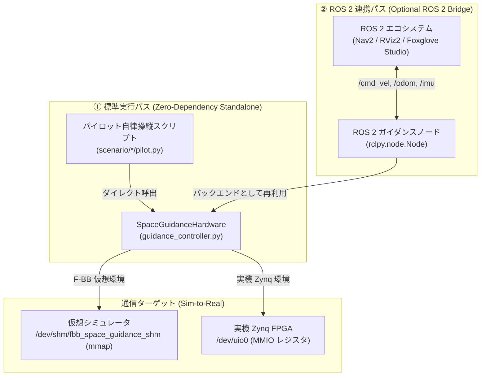

# SpaceGuidance-FBB ROS 2 ＆ ハードウェア・クライアント・ドライバ層

本ディレクトリ（`ros2/`）は、SpaceGuidance-FBB における **ガイダンス・ファームウェア（上位フライトソフトウェア）とハードウェア（仮想シミュレータ / 実機 FPGA）を仲介するハードウェア抽象化レイヤ（HAL: Hardware Abstraction Layer）** の実装と設計指針を管理しています。

---

## 1. コア設計思想: 「外部依存なしの即時実行」＋「ROS 2 エコシステムへの拡張性」

本ディレクトリは `ros2/` という名称を持っていますが、中核となるドライバ [`ros2/nodes/guidance_controller.py`](./nodes/guidance_controller.py) は **あえて ROS 2 (`rclpy`) をハードコードで必須とせず、Python 標準ライブラリのみで完結するピュア Python** として実装されています。



### あえて「ピュア Python」に徹した 3 つの工学的理由

1. **環境依存の完全排除（どこでも 0.1 秒で即座起動）**:
   * ROS 2（Humble や Iron 等）のパッケージ群（DDS 通信層、colcon ビルドシステム、多数の C++ 共有ライブラリ）のインストールが不要です。
   * 素の Linux、最小構成の Docker コンテナ、GitHub Actions の CI/CD、または実機 Zynq の Yocto/Alpine Linux 上でも、`python3 pilot.py` 一発で即座に動作します。
2. **20ms (50Hz) 決定論的リアルタイムループのジッター排除**:
   * 通信ミドルウェア（DDS のパケットシリアライズ/デシリアライズ）を経由せず、共有メモリ（`mmap`）や UIO レジスタへ直接アクセスするため、マイクロ秒オーダーの超高速・確定的な同期が可能です。
3. **初学者・制御工学への集中**:
   * 初学者や教育競技において、ROS 2 の複雑なノード管理（`rclpy.init()`, `spin()`, QoS 設定等）に煩わされることなく、純粋な姿勢制御アルゴリズム（PD 制御、微分ダンピング、推測航法、FDIR）の設計に集中できます。

---

## 2. モジュール構成

| モジュール名 | ファイルパス | 責務と特徴 |
| :--- | :--- | :--- |
| **Hardware Driver** | [`nodes/guidance_controller.py`](./nodes/guidance_controller.py) | **Sim-to-Real 透過ドライバ (`SpaceGuidanceHardware`)**<br>・仮想環境（`/dev/shm`）と実機 Zynq（`/dev/uio0`）の自動フォールバック<br>・Seqlock ロックフリー・リトライループによる 6-DoF テレメトリの分断のない一貫した取得（ティアフリー読み取り）<br>・ハードウェアウォッチドッグの定期キック (`kick_watchdog`)<br>・Zynq PS UART1（`/dev/ttyPS1`）への透過的複製出力 (`UartTee`) |

---

## 3. 主要 API 仕様 (`SpaceGuidanceHardware`)

ガイダンススクリプト（`pilot.py`）や ROS 2 ノードから使用する主要インターフェースです：

```python
from guidance_controller import SpaceGuidanceHardware

hw = SpaceGuidanceHardware()

# 1. テレメトリの取得 (辞書および属性アクセスの両対応)
tlm = hw.read_registers()
pos_x = tlm.pos_x          # 3次元位置 (m)
roll  = tlm.roll           # ロール姿勢角 (rad)
rpm   = tlm.wheel_rpm      # リアクションホイール回転数

# 2. ウォッチドッグのキック (10ms ハードウェアタイムアウト防止)
hw.kick_watchdog()

# 3. 推進・姿勢コマンドの出力 (Q16.16 固定小数点へ自動変換)
hw.write_commands(
    thrust_x=0.5,           # X軸推進力 (-1.0 ~ +1.0)
    thrust_y=0.2,           # Y軸横移動 (-1.0 ~ +1.0)
    torque=-0.1,            # 旋回トルク (-1.0 ~ +1.0)
    wheel_torque=0.05,      # リアクションホイール目標トルク
    fdir_mode=0             # 0: Nominal, 1: LOS, 2: Station-Keeping
)

# 4. 公式評価サマリーの出力 (OfficialReferee SSOT)
hw.print_summary("STAGE 1 MISSION")
```

---

## 4. ROS 2 との連携（拡張方法）

ROS 2 のツールチェーン（Nav2、RViz2、Foxglove Studio、BehaviorTree.CPP 等）と統合したい場合は、`SpaceGuidanceHardware` をバックエンドとして呼び出すラッパーノードを作成することで、既存のフライトロジックを変更することなくシームレスに拡張できます。

### ROS 2 ブリッジノードの実装例

```python
#!/usr/bin/env python3
# ros2/nodes/space_guidance_ros2_bridge.py (拡張例)
import rclpy
from rclpy.node import Node
from geometry_msgs.msg import Twist
from nav_msgs.msg import Odometry
from guidance_controller import SpaceGuidanceHardware

class SpaceGuidanceBridgeNode(Node):
    def __init__(self):
        super().__init__('space_guidance_bridge')
        self.hw = SpaceGuidanceHardware()
        self.hw.engage()

        # サブスクライバー: ROS 2 からの速度・推力指令を受信
        self.sub_cmd = self.create_subscription(Twist, '/cmd_vel', self.cmd_callback, 10)

        # パブリッシャー: 宇宙機の 6-DoF オドメトリを配信
        self.pub_odom = self.create_publisher(Odometry, '/odom', 10)

        # 50Hz (20ms) 制御・監視タイマー
        self.timer = self.create_timer(0.02, self.timer_callback)

    def cmd_callback(self, msg: Twist):
        self.hw.write_commands(
            thrust_x=msg.linear.x,
            thrust_y=msg.linear.y,
            torque=msg.angular.z
        )

    def timer_callback(self):
        self.hw.kick_watchdog()
        tlm = self.hw.read_registers()

        odom = Odometry()
        odom.header.stamp = self.get_clock().now().to_msg()
        odom.header.frame_id = 'odom'
        odom.pose.pose.position.x = tlm.pos_x
        odom.pose.pose.position.y = tlm.pos_y
        odom.pose.pose.position.z = tlm.get('pos_z', 0.0)
        self.pub_odom.publish(odom)

def main():
    rclpy.init()
    node = SpaceGuidanceBridgeNode()
    try:
        rclpy.spin(node)
    except KeyboardInterrupt:
        pass
    finally:
        node.hw.close()
        node.destroy_node()
        rclpy.shutdown()

if __name__ == '__main__':
    main()
```

