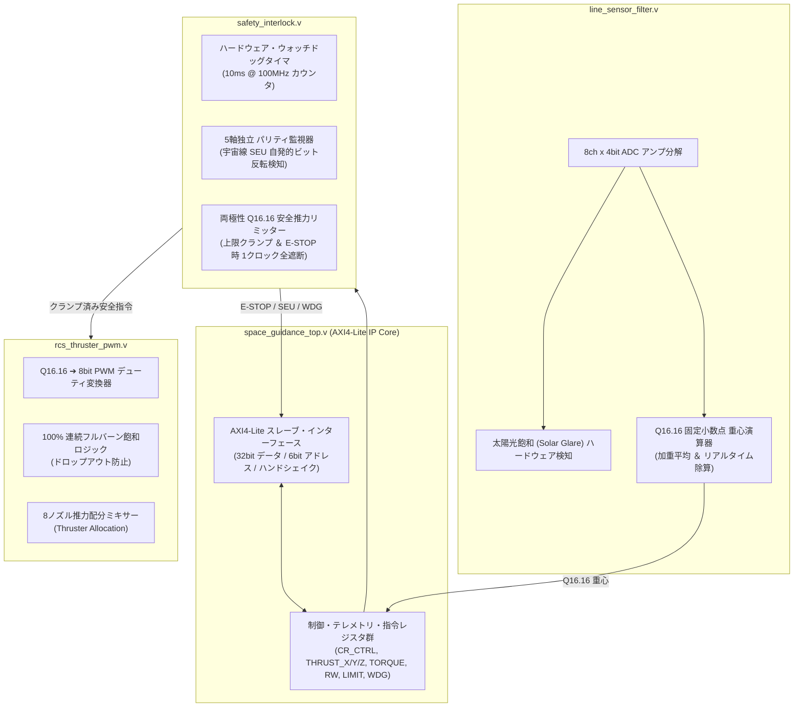
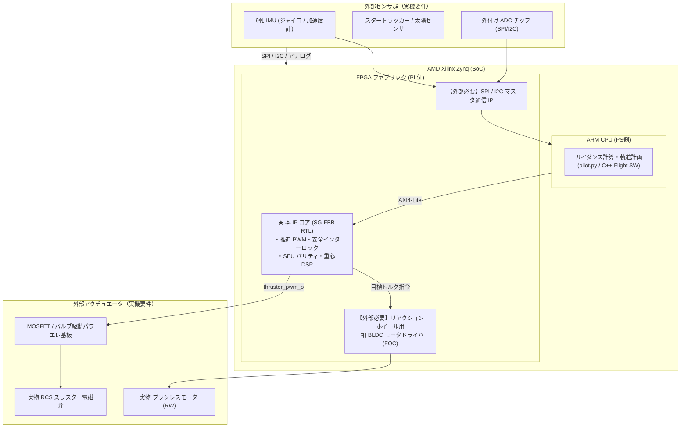

# SpaceGuidance-FBB RTL IP Core: 航空宇宙仕様 AXI4-Lite ガイダンス＆安全監視サブシステム

本ディレクトリ（`rtl/`）には、SpaceGuidance-FBB の宇宙機ガイダンス・航法・制御（GNC）およびフェイルセーフを担う **AXI4-Lite 準拠のハードウェア IP コア** の Verilog-HDL ソースコードが格納されています。

実機（AMD Xilinx Zynq-7000 / Zynq UltraScale+）への論理合成（Vivado）および、Verilator によるサイクル精度シミュレーション（F-BB Co-simulation）の双方に完全対応しています。

---

## 1. サブシステム全体アーキテクチャ

本 IP コアは、ソフトウェア（CPU / Linux / RTOS / `pilot.py`）が暴走・遅延した場合でも機体の致命的破損を防ぐため、**「ハードウェア主導の自律安全インターロック」** を中核に据えた 4 つの協調モジュールで構成されています。



---

## 2. モジュール一覧と責務

| モジュール名 | ファイル名 | 規模 | 主な機能と責務 |
| :--- | :--- | :---: | :--- |
| **Top-Level IP Core** | [`space_guidance_top.v`](./space_guidance_top.v) | ~240行 | AXI4-Lite スレーブバスIF、レジスタデコード、サブモジュール統合、割込（IRQ）生成 |
| **Sensor DSP Filter** | [`line_sensor_filter.v`](./line_sensor_filter.v) | ~55行 | 8ch ADC 信号処理、太陽光グレア飽和検知、Q16.16 センサ重心リアルタイム計算 |
| **Safety Interlock** | [`safety_interlock.v`](./safety_interlock.v) | ~120行 | ウォッチドッグタイマ、5軸独立 SEU パリティ監視、安全推力クランプ、E-STOP 遮断 |
| **Thruster PWM Mixer** | [`rcs_thruster_pwm.v`](./rcs_thruster_pwm.v) | ~75行 | 符号付き Q16.16 から 8bit PWM への変換、100% フルバーン回路、8 ノズル推力配分 |

---

## 3. レジスタマップ (Memory-Mapped I/O)

AXI4-Lite バスからアクセス可能なレジスタ一覧です（ベースアドレスは DTS の `reg` 属性に準拠）。

| オフセット | レジスタ名 | アクセス | 型 / 形式 | 説明 |
| :---: | :--- | :---: | :---: | :--- |
| `0x00` | **`CR_CTRL`** | R/W | `uint32` | 制御レジスタ<br>・Bit 0: `SYSTEM_ENABLE` (1 で回路動作有効化)<br>・Bit 1: `MANUAL_ESTOP` (1 で手動緊急停止)<br>・Bit 3: `ENGAGE_MISSION` (ミッションタイマー開始フラグ) |
| `0x04` | **`SR_STATUS`** | R | `uint32` | ステータスレジスタ<br>・Bit 0: `SYSTEM_ENABLE_STATUS`<br>・Bit 1: `ESTOP_TRIPPED` (非常停止発動中)<br>・Bit 2: `SEU_ALERT` (宇宙線ビット反転検知)<br>・Bit 3: `WDG_TIMEOUT` (ウォッチドッグ満了) |
| `0x08` | **`SENSOR_RAW`** | R | `uint32` | 8ch 光学ラインセンサ ADC 生値（各 4-bit $\times$ 8チャンネル） |
| `0x0C` | **`SENSOR_EDGE`** | R | `int32` (Q16.16) | センサ重心位置（$-3.5 \sim +3.5$ ピッチ単位、中央が `0.0`） |
| `0x10` | **`THRUST_CMD_X`**| R/W | `int32` (Q16.16) | X軸主推力指令値（$-1.0 \sim +1.0$、前進/後進） |
| `0x14` | **`THRUST_CMD_Y`**| R/W | `int32` (Q16.16) | Y軸横移動推力指令値（$-1.0 \sim +1.0$、左舷/右舷） |
| `0x18` | **`THRUST_CMD_Z`**| R/W | `int32` (Q16.16) | Z軸垂直推力指令値（$-1.0 \sim +1.0$、ダウンフォース/上昇） |
| `0x1C` | **`TORQUE_CMD`**  | R/W | `int32` (Q16.16) | RCS 旋回トルク指令値（$-1.0 \sim +1.0$、ヨー軸回転） |
| `0x20` | **`SAFETY_LIMIT`**| R/W | `uint32` (Q16.16)| ハードウェア安全限界値（各軸の最大許容絶対値、デフォルト `1.0`） |
| `0x24` | **`WATCHDOG_KICK`**| W | ストローブ | ウォッチドッグタイマリセット（書き込み時にカウンタを初期値へリロード） |
| `0x28` | **`CHAOS_FAULT_INJ`**| R/W | `uint32` | カオス障害注入レジスタ<br>・Bit 0: `CHAOS_SEU_INJECT` (1 で SEU アラート擬似トリップ) |
| `0x2C` | **`WHEEL_TORQUE_CMD`**| R/W | `int32` (Q16.16)| リアクションホイール（電気駆動）目標トルク指令値 |

---

## 4. 航空宇宙仕様・本格安全設計の詳細解説

### ① 宇宙放射線（SEU: Single Event Upset）のハードウェアパリティ監視
宇宙環境では高エネルギー宇宙線により、レジスタのフリップフロップが突然反転する「SEU（ソフトエラー）」が発生します。
* **独立 5-bit パリティ（`stored_parity`）**:
  一般的な全体排他的論理和（XOR）では、偶数個のビットが同時に化けた際にキャンセルされて見落とすリスクがあります。
  本回路では、5軸のアクチュエータ指令（Wheel Torque, Z, Yaw Torque, Y, X）それぞれに対して独立した 1-bit パリティを割り当てています：
  ```verilog
  wire [4:0] current_parity = {^wheel_torque_cmd_i, ^thrust_z_cmd_i, ^torque_cmd_i, ^thrust_y_cmd_i, ^thrust_x_cmd_i};
  ```
* **自発的ビット反転のトラップ**:
  CPU による書き込みストローブ（`command_write_strobe_i`）がないタイミングで `current_parity != stored_parity` を検知した場合、ハードウェアが自律的に `seu_alert_o` をアサートし、即座にフェイルセーフへ遷移します。

### ② ハードウェア安全リミッター ＆ E-STOP（フェイルセーフ）
* **絶対値超過のリアルタイムクランプ**:
  ソフトウェアのゲイン発散やバグにより指令値が `safety_limit_i` を超えた場合、ハードウェア側で符号判定を行い、許容最大値（$\pm \text{safety\_limit}$）へ自動クリッピングします。
* **1クロック即時全遮断**:
  `manual_estop_i`、`wdg_timeout_o`、`seu_alert_o` のいずれかがトリップした場合、全アクチュエータ出力（X, Y, Z, Torque, Wheel）を 1 サイクルで強制ゼロ（`32'd0`）へ遮断し、推力暴走を物理的に阻止します。

### ③ 100% 連続フルバーン PWM（ドロップアウト防止）
一般的な 8-bit カウンタ比較型 PWM（`duty > counter`）では、最大値 `255 (0xFF)` を設定してもカウンタが `255` に達した瞬間に 1 サイクルだけ `0` に落ちる「ドロップアウト（$255/256 \approx 99.6\%$）」が発生します。
本回路では飽和判定回路を組み込み、最大噴射時の**完全連続燃焼（真の 100.00% 連続通電）** を保証しています：
```verilog
wire is_active_x = (duty_x == 8'hFF) ? 1'b1 : (duty_x > pwm_counter);
```

### ④ 固定小数点 Q16.16 センサ重心 DSP
浮動小数点演算器（FPU）を搭載すると FPGA の LUT/DSP スライスを大量に消費するため、センサの加重平均演算は固定小数点 Q16.16 整数演算で完結させています。除算結果から基準オフセット（$3.5 \times 65536 = 229376$）を減算することで、ゼロセンタリングされた精密な重心偏差が得られます。

---

## 5. 実機（実宇宙機）展開における責務境界とオミット（簡略化）事項

本 IP コアは、実機 FPGA（Zynq 等）に書き込めばそのまま電磁弁を駆動できる完全な論理合成回路ですが、アビオニクス（航空宇宙電子機器）全体における役割は **「推進系・安全監視サブシステム（Propulsion & Safety Interlock Subsystem）」** に特化しています。

そのため、**「もし本当に物理的な機体（フライトモデル）を製作して自律飛行させる場合」** は、以下の機能がアビオニクス全体として必要となり、本 IP コア内部では意図的にオミット（抽象化、または外付け前提）されています。



### 実機展開時の機能スコープ対比表

| 機能カテゴリ | 本 IP コアの実装状況 | 実宇宙機（フライトモデル）展開時の要件 / オミット理由 |
| :--- | :---: | :--- |
| **スラスター電磁弁 PWM 駆動** | **◎ 完全実装** | `thruster_pwm_o[7:0]` から実機の FET パワエレ基板へ直結してガスバルブを開閉可能。 |
| **安全インターロック & E-STOP** | **◎ 完全実装** | ウォッチドッグ満了時や SEU 発生時に 1 クロックで推力を強制全閉にする実機安全回路。 |
| **宇宙線 SEU パリティ監視** | **◎ 完全実装** | レジスタの自発的ビット反転（ソフトエラー）を自律検知してアラートをトリップ。 |
| **光学センサ重心 DSP** | **◎ 完全実装** | 8ch ADC から Q16.16 固定小数点除算によりリアルタイムに重心を算出。 |
| **外部センサ通信 (SPI/I2C/XADC)** | **△ オミット**<br>(パラレル入力) | 本回路は `raw_sensor_adc_i`（32-bit パラレル）として受ける設計。実機では外部 ADC チップや IMU と通信するための **SPI / I2C マスタ IP、または Xilinx XADC/SYSMON** を外側に配置する必要があります。 |
| **リアクションホイール駆動 (FOC)** | **△ オミット**<br>(目標トルク出力) | 本回路は目標トルク値（`WHEEL_TORQUE_CMD`）を出力・保持するのみです。実物の三相ブラシレス DC モータを駆動するには、**ベクトル制御（FOC）PWM 生成回路やエンコーダ読取回路（QEI）** を外付けする必要があります。 |
| **パワエレ・アナログ駆動層** | **× オミット**<br>(デジタル信号のみ) | FPGA の 3.3V LVCMOS 出力では実物の 12V/24V 高圧ガス弁を駆動できないため、**フライバックダイオード付き MOSFET スイッチング基板** が物理的に必須となります。 |
| **高度航法センサ (IMU / Star Tracker)** | **× オミット**<br>(上位FW責務) | ジャイロやスタートラッカー等の航法データ取得とカルマンフィルタ計算は、Zynq PS 側（CPU 上のフライトソフトウェア）の責務として分離されています。 |

---

## 6. 合成・検証環境

* **実機 FPGA 合成**:
  AMD Xilinx Vivado にて「Create and Package New IP」ウィザードから本ディレクトリの Verilog ファイルを読み込ませることで、そのまま Block Design（IP Integrator）上に AXI4-Lite ペリフェラルとして配置可能です。
* **F-BB 仮想検証**:
  Verilator により C++ クラスへトランスパイルされ、`SpaceGuidance-FBB` のシミュレータ環境でミリ秒単位のクロックサイクル精度で協調動作します。

