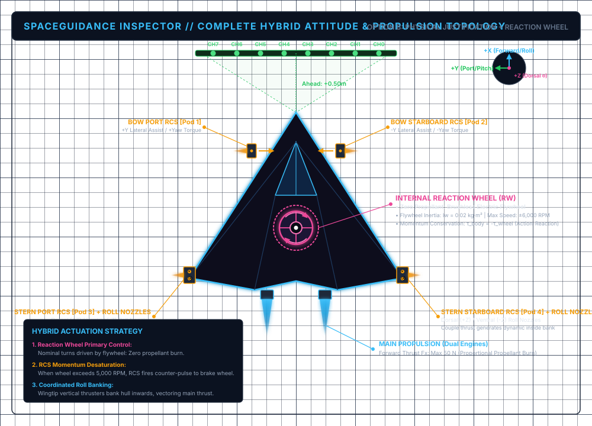

# Stage 1: 小惑星パイプライン巡回 (Asteroid Pipeline Inspector)

**難易度: Level 1 (入門) | 物理空間: 3D微小重力・立体起伏回廊 (3D Bank-to-Translate)**

---

## 1. ミッション概要 (Mission Overview)

不規則な微小重力小惑星の立体的な峡谷・稜線に沿って敷設された燃料輸送パイプライン（反射テープライン）に沿って自律宇宙探査機を航行させ、全9箇所の3Dチェックポイントゲートを検査・通過するミッションです。

本ステージは従来の2次元平面コースから大幅に進化し、**左右（Y軸）だけでなく上下（Z軸）にもうねる3次元立体起伏回廊**へと拡張されています。
完全無摩擦の真空宇宙環境において、機体をロール角 $\phi$ に傾ける（バンクさせる）ことで、横移動（ラテラル）RCSスラスタ $F_y$ の噴射推力が以下のように水平および垂直成分へと同時に物理分配されます：

$$F_{\text{world}, y} = F_y \cos\phi, \quad F_{\text{world}, z} = F_y \sin\phi$$

これにより、専用の垂直昇降スラスタを大量に搭載することなく、**「旋回方向へ機体をバンクさせ、横スラスタで3次元起伏を滑走する（Bank-to-Translate）」という本物の宇宙航法力学**を攻略の中核として体験できます。

---

## 2. ミッションブリーフィング：機体仕様・推進トポロジー (Pre-Flight Briefing: Spacecraft & Flight Corridor)

本シナリオに挑む自律航法パイロットは、発進前に以下の機体ハードウェア・アクチュエータ仕様およびコース回廊仕様をブリーフィング情報として把握できます。機上プログラム（`pilot.py`）にこれらの情報を事前計画（カンペ / ウェイポイント記憶）として組み込み、効率的な自律誘導に役立てることが可能です。



### (1) 機体物理諸元 (Physical Properties)
* **乾燥質量 ($M$)**: $100.0\text{ kg}$（中型自律深宇宙探査機クラス）
* **ヨー軸慣性モーメント ($I_{zz}$)**: $25.0\text{ kg}\cdot\text{m}^2$
* **ロール軸慣性モーメント ($I_{xx}$)**: $15.0\text{ kg}\cdot\text{m}^2$
* **幾何学的回転半径 (Radius of Gyration)**: $r_{g,z} = \sqrt{I_{zz} / M} = 0.50\text{ m}, \; r_{g,x} = \sqrt{I_{xx} / M} = 0.387\text{ m}$
* **機体寸法**: 全長 $3.5\text{m}$（機首センサ端〜テールノズル後端）, 全幅 $3.6\text{m}$（翼端RCSポッド間）
* **力学環境**: 完全無摩擦・微小重力の深宇宙軌道空間（ニュートンの3次元運動方程式に基づく慣性航行）

### (2) 推進・アクチュエータ系出力仕様 & 制御入力換算式
探査機の推進制御レジスタ（MMIO）は、実機FPGA互換の 32-bit 符号付き Q16.16 固定小数点形式（$1.0 = \text{0x00010000} = 65,536$）を採用しています。Python や C 言語で制御器を設計する際は、正規化指令値 $u \in [-1.0, +1.0]$ を書き込むことで、物理エンジンが以下の実世界物理量へ換算して推進力・トルクを発生させます。

#### ① メイン推進スラスタ (Dual Aft Main Engines: `thrust_cmd_x`)
* **配置**: 機体尾部後端にツイン配置（`Nozzle L`, `Nozzle R`）。
* **レジスタ換算式**:
  $$F_x = \frac{\text{thrust\_cmd\_x}}{65,536} \times 50.0\text{ N} \quad (-50.0\text{ N} \le F_x \le +50.0\text{ N})$$
* **最大並進加速度**:
  $$a_{x,\max} = \frac{F_{x,\max}}{M} = \frac{50.0\text{ N}}{100.0\text{ kg}} = 0.50\text{ m/s}^2$$

#### ② ラテラル並進スラスタ (Lateral Translation RCS: `thrust_cmd_y`)
* **配置**: 機首・翼端の4箇所スラスタポッド。
* **レジスタ換算式**:
  $$F_y = \frac{\text{thrust\_cmd\_y}}{65,536} \times 50.0\text{ N} \quad (-50.0\text{ N} \le F_y \le +50.0\text{ N})$$
* **3D Bank-to-Translate 推進合成**:
  機体がロールバンク角 $\phi$、ヨー角 $\psi$ にあるとき、ワールド慣性系への推力配分は以下となります：
  $$F_{\text{world}, x} = F_x \cos\psi - F_y \cos\phi \sin\psi$$
  $$F_{\text{world}, y} = F_x \sin\psi + F_y \cos\phi \cos\psi$$
  $$F_{\text{world}, z} = F_y \sin\phi$$

#### ③ RCS 姿勢制御スラスタ (Attitude RCS Thrusters: `torque_cmd`)
* **配置**: 翼端および機首の対向偶力ノズル群。
* **レジスタ換算式**:
  $$\tau_{\text{rcs}} = \frac{\text{torque\_cmd}}{65,536} \times 20.0\text{ N}\cdot\text{m} \quad (-20.0\text{ N}\cdot\text{m} \le \tau_{\text{rcs}} \le +20.0\text{ N}\cdot\text{m})$$
* **最大角加速度**:
  $$\alpha_{\text{rcs},\max} = \frac{\tau_{\text{rcs},\max}}{I_{zz}} = \frac{20.0\text{ N}\cdot\text{m}}{25.0\text{ kg}\cdot\text{m}^2} = 0.80\text{ rad/s}^2 \approx 45.84^\circ/\text{s}^2$$

#### ④ 3軸リアクションホイール (Reaction Wheel Array: `wheel_torque_cmd`, `wheel_torque_x`)
* **配置**: 機体重心（CoM）に同軸搭載された電動フライホイール群（Yaw軸およびRoll軸）。
* **推進剤消費ゼロ**: バッテリー電力のみで駆動し、推進剤（Delta-V）を一切消費せずに精密な角運動量制御を実現。
* **ホイール物理特性**:
  * フライホイール慣性モーメント: $I_w = 0.02\text{ kg}\cdot\text{m}^2$
  * 定格・限界回転数: $\pm 6,000\text{ RPM} \implies \omega_{w,\max} = 6000 \times \frac{2\pi}{60} \approx 628.32\text{ rad/s}$
* **反作用トルク (Newton's 3rd Law)**:
  $$\tau_{\text{wheel}} = \frac{\text{wheel\_torque\_cmd}}{65,536} \times 20.0\text{ N}\cdot\text{m}, \quad \tau_{\text{body}} = -\tau_{\text{wheel}}$$
  $$\tau_{\text{wheel},x} = \frac{\text{wheel\_torque\_x}}{65,536} \times 20.0\text{ N}\cdot\text{m}, \quad \tau_{\text{body},x} = -\tau_{\text{wheel},x}$$

#### ⑤ 推進剤（燃料）消費モデル
$$\frac{d(\text{Fuel})}{dt} = - \left( |F_x| + |F_y| + |\tau_{\text{rcs}}| + |\tau_{\text{rcs},x}| \right) \times 0.0005 \quad [\%/\text{s}]$$
※リアクションホイール（$\tau_{\text{wheel}}$）による姿勢制御は燃料消費がゼロです。

### (3) センサ系
* **8ch 光学センサアレイバー**:
  * 機首前方 0.5m に搭載（4bit ADC × 8ch、各ch間隔 0.05m、全幅 0.35m）。
  * 機体のロール角 $\phi$ およびヨー角 $\psi$ に連動して 3D 空間上で回転投影され、3Dレーザーガイドラインの距離をリアルタイム検知。
* **FPGA RTL重心演算回路 (`line_sensor_filter.v`)**:
  * ハードウェア回路が幾何学的重心をナノ秒で計算し、偏差（`ADDR_SENSOR_EDGE`: `0x43C0000C`、符号付き Q16.16: -3.5〜+3.5 素子ピッチ単位、0.0が中央）として出力。

### (4) 3D飛行回廊およびチェックポイントゲート仕様 (Corridor & Gate Specs)
* **回廊仕様**: 全長 $50.0 \text{ m}$ の3次元立体起伏小惑星採掘パイプライン回廊（光学反射ガイドライン敷設）。
  * 第1立体カーブ ($10.0\text{m} < X \le 25.0\text{m}$):
    $$Y(x) = +2.5 \sin\left(\frac{x - 10}{15}\pi\right), \quad Z(x) = +1.5 \sin\left(\frac{x - 10}{15}\pi\right)$$
    左カーブかつ標高 $+1.5\text{m}$ の峠を越える回廊 $\implies$ 最適バンク角 $\phi = +\arctan(1.5 / 2.5) \approx +31.0^\circ$（左バンク）
  * 第2立体カーブ ($25.0\text{m} < X \le 40.0\text{m}$):
    $$Y(x) = -2.5 \sin\left(\frac{x - 25}{15}\pi\right), \quad Z(x) = +1.5 \sin\left(\frac{x - 25}{15}\pi\right)$$
    右カーブかつ標高 $+1.5\text{m}$ の峠を越える回廊 $\implies$ 最適バンク角 $\phi = -\arctan(1.5 / 2.5) \approx -31.0^\circ$（右バンク）
* **ゲート開口枠**: 半径 $0.5 \text{ m}$（全幅 $1.0 \text{ m}$）の電磁六角形リングゲート。
* **ゲート配置 (計9箇所・3D座標)**:
  * Gate 01: $X = 5.0\text{m}, \; Y = 0.0\text{m}, \; Z = 0.0\text{m}$ (進入路)
  * Gate 02: $X = 10.0\text{m}, \; Y = 0.0\text{m}, \; Z = 0.0\text{m}$ (第1立体カーブ入口)
  * Gate 03: $X = 15.0\text{m}, \; Y = +2.17\text{m}, \; Z = +1.30\text{m}$ (第1立体カーブ登り坂)
  * Gate 04: $X = 20.0\text{m}, \; Y = +2.17\text{m}, \; Z = +1.30\text{m}$ (第1立体カーブ下り坂)
  * Gate 05: $X = 25.0\text{m}, \; Y = 0.0\text{m}, \; Z = 0.0\text{m}$ (切り返し中間地点)
  * Gate 06: $X = 30.0\text{m}, \; Y = -2.17\text{m}, \; Z = +1.30\text{m}$ (第2立体カーブ登り坂)
  * Gate 07: $X = 35.0\text{m}, \; Y = -2.17\text{m}, \; Z = +1.30\text{m}$ (第2立体カーブ下り坂)
  * Gate 08: $X = 40.0\text{m}, \; Y = 0.0\text{m}, \; Z = 0.0\text{m}$ (第2立体カーブ出口)
  * Gate 09: $X = 45.0\text{m}, \; Y = 0.0\text{m}, \; Z = 0.0\text{m}$ (最終進入路)
* **航法戦術のヒント（Bank-to-Translate 戦術）**:
  ゲート手前 $2.5\text{m}$ でコース起伏を先読みし、ロールリアクションホイールで機体を $\pm 31^\circ$ にバンクさせます。バンク角を維持した状態で横スラスタ（$F_y$）を吹くことで、水平の遠心力打ち消しと垂直方向の登坂加速が同時に得られ、3Dゲート中心を PERFECT（$\le 5.0\text{cm}$）で射抜くことができます。
* **公式審判（SSOT）との関係**:
  パイロットが機上フライトプラン（`pilot.py` 内の `gate_x_list` カンペ）としてどの座標を保持して操縦しようと自由ですが、**実際のゲート通過判定・3次元空間偏差判定は物理シミュレータ側（`OfficialReferee`）が厳格かつ独立して実施**します。

---

## 3. ゲームプレイループとハッキングガイド

### (1) 編集対象ファイル
プレイヤーがアルゴリズムやパラメータをチューニングする対象ファイル：
```text
~/.fbb/plugins/SpaceGuidance-FBB/scenario/01_asteroid_pipeline/pilot.py
（※ローカル開発環境の場合は /workspaces/SpaceGuidance-FBB/scenario/01_asteroid_pipeline/pilot.py）
```

### (2) 即時反映のやり方 (Rapid Re-flight Loop)
1. VS Code で `scenario/01_asteroid_pipeline/pilot.py` を開きます。
2. 後述の **TUNE ZONE 1〜3** のゲインや巡航速度を書き換えて保存（`Ctrl + S`）します。
3. Webダッシュボード（`http://localhost:8080`）の **`Chaos & Fault Injection`** パネルにある **`[Restart Scenario]`** ボタンをクリックします。
4. 新しいパラメータで即座に探査機が発進し、3Dビューアおよびコンソールでスコアの変化を確認できます。

### (3) 初期状態へのリセット方法
```bash
# プラグインルート（~/.fbb/plugins/SpaceGuidance-FBB）にて実行
cp examples/mission01_baseline_pilot.py scenario/01_asteroid_pipeline/pilot.py
```

### (4) pilot.py 自律操縦ロジック・制御ループ全体図 (50Hz / 20ms)

探査機が 50Hz 周期（20ms）で自律実行しているテレメトリ取得、幾何重心の微分計算、PD姿勢誘導、リアクションホイールと RCS の脱飽和、および並進推力配分の処理フローです。後述の **TUNE ZONE 1〜3** がどの計算ブロックに作用しているかを明確に示しています。

```mermaid
flowchart TD
    %% スタイル定義
    classDef start_end fill:#1e293b,stroke:#94a3b8,stroke-width:2px,color:#f8fafc;
    classDef io fill:#0f172a,stroke:#38bdf8,stroke-width:2px,color:#f8fafc;
    classDef compute fill:#1e1b4b,stroke:#818cf8,stroke-width:2px,color:#f8fafc;
    classDef branch fill:#312e81,stroke:#a855f7,stroke-width:2px,color:#f8fafc;
    classDef rw fill:#064e3b,stroke:#34d399,stroke-width:2px,color:#f8fafc;
    classDef rcs fill:#701a75,stroke:#f472b6,stroke-width:2px,color:#f8fafc;

    START(["起動: run_pilot()<br/>UartTee('/dev/ttyPS1') & SpaceGuidanceHardware()"]):::start_end --> INIT["パラメータ・状態初期化<br/>kp, kd, kw, klat, target_vx / 制御周期 50Hz (dt=20ms)"]:::compute
    
    INIT --> LOOP_START{"50Hz メイン制御ループ"}:::branch

    %% 1. センシング
    subgraph SENSE["1. テレメトリ取得 & 安全監視 (Sensing & Safety)"]
        LOOP_START --> READ["hw.read_registers()<br/>位置(x,y,z), 速度(vx,vy,vz), ヨー角θ, ロール角φ, 角速度(ω,ωx), ホイールRPM, 燃料"]:::io
        READ --> WDT["hw.kick_watchdog()<br/>ハードウェア非常停止(E-STOP)の防止"]:::io
        WDT --> EDGE["光学センサ偏差 & 微分計算<br/>重心偏差: e = raw_edge / 65536<br/>微分値: de = (e - prev_e) / dt"]:::compute
    end

    %% 2. ゴール・審判
    subgraph GOAL_CHECK["2. 審判チェックポイント & 終了判定 (Referee Check)"]
        EDGE --> GATE["3Dゲート通過報告 (X=5m〜45m, 標高Z=0〜1.3m)"]:::compute
        GATE --> GOAL{"X >= 49.0m<br/>(ゴール到達?)"}:::branch
        GOAL -- YES --> FINISH["公式審判スコア表示 (SSOT)<br/>Official Grade, Score, Bonus"]:::io --> CLEANUP
    end

    %% 3. 3D起伏先読み & ロールバンク制御
    subgraph BANK_GUIDE["3. 3D起伏先読み & ロールバンク誘導 (Bank-to-Translate)"]
        GOAL -- NO --> LOOKAHEAD["3D起伏先読み (Lookahead 2.5m)<br/>・第1立体カーブ: 目標バンク φ = +31.0°<br/>・第2立体カーブ: 目標バンク φ = -31.0°"]:::compute
        LOOKAHEAD --> ROLL_PD["【TUNE ZONE 1】 ロールリアクションホイール PD制御<br/>wheel_torque_x = -(kp_roll * (φ_target - φ) - kd_roll * ωx)"]:::rw
    end

    %% 4. 運動学変換 & Yaw PD
    subgraph GUIDANCE["4. 座標変換 & Yaw PD誘導 (Guidance & Yaw Control)"]
        ROLL_PD --> BODY_TRANS["機体座標系 (Body Frame) 速度計算<br/>v_fwd = vx*cosθ + vy*sinθ (進行方向速度)<br/>v_lat = -vx*sinθ + vy*cosθ (横滑り速度)"]:::compute
        BODY_TRANS --> PD_TORQUE["【TUNE ZONE 1】 目標Yaw姿勢トルク計算 (PD Control)<br/>target_torque = (kp*e + kd*de) - kw*ω"]:::compute
    end

    %% 5. ハイブリッド姿勢制御 (RW vs RCS)
    subgraph HYBRID["5. ハイブリッド姿勢制御・脱飽和 (Hybrid AOCS Allocation)"]
        PD_TORQUE --> CHECK_DESAT{"【TUNE ZONE 3】 脱飽和判定<br/>|wheel_rpm| > 5200 RPM ?"}:::branch
        
        CHECK_DESAT -- "通常域 (RPM 正常)" --> RW_MODE["リアクションホイール優先 (電気駆動・燃料0)<br/>wheel_torque_cmd = -target_torque<br/>rcs_torque_cmd = 0.0"]:::rw
        
        CHECK_DESAT -- "飽和域 (RPM 超過)" --> RCS_MODE["RCS脱飽和アンローディング (推進剤消費)<br/>・RCS が姿勢維持を肩代わり<br/>・ホイールに逆制動トルク印加して減速"]:::rcs
    end

    %% 6. 並進推力 & 出力
    subgraph ACTUATION["6. 並進推力配分 & ハードウェア指令出力 (Actuation)"]
        RW_MODE --> TRANS_CMD
        RCS_MODE --> TRANS_CMD
        
        TRANS_CMD["並進スラスタ指令計算<br/>・【TUNE ZONE 1】 横移動 RCS: lat_cmd = klat*e - kvlat*v_lat (不感帯2cm)<br/>　※バンク角φにより Fy*cosφ (水平) と Fy*sinφ (垂直) に自動合成！<br/>・【TUNE ZONE 2】 前進メイン: thrust_x = 0.25 * (target_vx - v_fwd)"]:::compute
        
        TRANS_CMD --> WRITE["hw.write_commands(...)<br/>thrust_x, thrust_y, torque, wheel_torque, wheel_torque_x, fdir_mode"]:::io
        WRITE --> SLEEP["time.sleep(dt=0.02)"]:::io
        SLEEP --> LOOP_START
    end

    subgraph CLEANUP["終了・安全保護 (Safe Shutdown)"]
        CLEANUP_EXEC["hw.write_commands(0, 0, 0, 0)<br/>全スラスタ・ホイール停止<br/>hw.close() & tee.close()"]:::start_end
    end
```




---

## 4. アーケード採点・公式審判システム (Official Referee SSOT)

公平な競技性を保証するため、採点および合否判定は Python 側ではなく中央デーモン（`space_guidance_daemon.cpp`）の **`OfficialReferee` エンジン** が 100Hz 周期でオーソリテーティブに実施します。

$$\text{Final Score} = \text{Checkpoint Score} + \text{Fuel Bonus} + \text{Time Bonus}$$

### (1) ゲート通過精度配点 (全9ゲート: X=5m, 10m, ..., 45m)
| 判定レーティング | 許容偏差基準 | 獲得ポイント | 説明 |
| :--- | :--- | :---: | :--- |
| **PASS [PERFECT]** | 偏差 $\le 5.0\text{ cm}$ | **$+1,000 \text{ pts}$** | ゲート中心を完璧に捉えて通過 |
| **PASS [GREAT]** | 偏差 $\le 12.0\text{ cm}$ | **$+800 \text{ pts}$** | わずかなズレで良好に通過 |
| **PASS [GOOD]** | 偏差 $\le 20.0\text{ cm}$ | **$+500 \text{ pts}$** | ゲート枠内を安全に通過 |
| **CLIP [PENALTY]** | 偏差 $\le 40.0\text{ cm}$ | **$-300 \text{ pts}$** | ゲート外枠に接触（減点ペナルティ） |
| **MISS [PENALTY]** | 偏差 $> 40.0\text{ cm}$ | **$-1,000 \text{ pts}$** | ゲート通過失敗・枠外逸脱（大減点） |

### (2) ボーナス配点
* **残燃料ボーナス**: 残推進剤 $\% \times 10.0$（最大 $+1,000\text{ pts}$、リアクションホイール活用で最大化）
* **クリアタイムボーナス**: $50.0\text{s}$ 未満でゴール到達時：
  $$\text{Time Bonus} = \max(0, (50.0 - \text{Elapsed Time}) \times 40.0)$$

### (3) フライトランク認定基準
* 🏆 **GRADE S (Elite Pilot)**: **$8,000 \text{ pts}$ 以上**（全ゲートPERFECT級、ハイスピード巡航、燃料無消費）
* 🥇 **GRADE A (Certified)**: **$6,500 \sim 7,999 \text{ pts}$**（標準クリア）
* 🥈 **GRADE B (Standard)**: **$4,500 \sim 6,499 \text{ pts}$**
* 🥉 **GRADE C (Pass)**: **$4,500 \text{ pts}$ 未満**

---

## 5. 攻略用 3大チューニングゾーン (Tune Zones)

`pilot.py` 内のコメント領域 `=== TUNE ZONE ===` を書き換えてハイスコアを狙います：

### 🎯 TUNE ZONE 1: 姿勢制御・ライン追従ゲイン (3D Bank-to-Translate)
```python
kp = 0.90       # 旋回比例ゲイン (Yaw: 水平ライン偏差に応じた回頭トルク)
kd = 0.15       # 旋回微分ゲイン (Yaw: S字カーブ入口・出口でのふらつき・ハンチング抑制)
kw = 0.65       # ジャイロ角速度ダンピング (Yaw: 無摩擦空間特有の回りすぎを抑制)
kp_roll = 1.40  # ロールバンク比例ゲイン (Roll: 3D起伏傾斜角への追従)
kd_roll = 0.28  # ロール角速度ダンピング (Roll: バンク時のロールオーバーシュート抑制)
klat = 0.85     # 横移動 RCS 追従ゲイン (バンク角度に沿った並進推力配分)
kvlat = 0.55    # 横滑り速度ダンピング (無重力空間特有の慣性横揺れ収束)
```

### 🚀 TUNE ZONE 2: 目標巡航速度
```python
target_vx = 1.2  # 目標巡航速度 (m/s) [タイム短縮と遠心力・立体勾配制御のトレードオフ]
```

### 🔋 TUNE ZONE 3: ハイブリッド制御 & リアクションホイール脱飽和
```python
# 5200 RPM以上で脱飽和開始、1800 RPM以下で通常復帰
if in_desat:
    if abs(wheel_rpm) < 1800.0:
        in_desat = False
else:
    if abs(wheel_rpm) > 5200.0:
        in_desat = True
```
