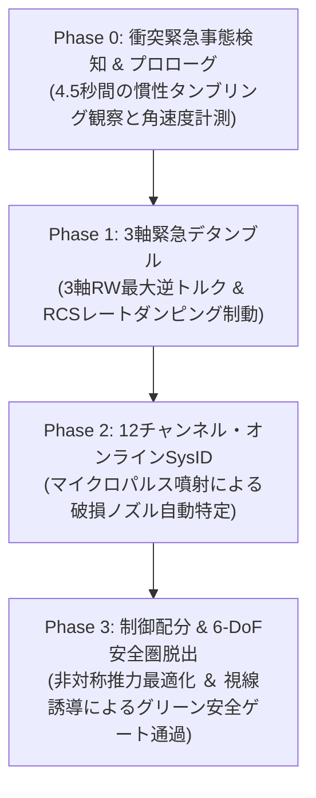
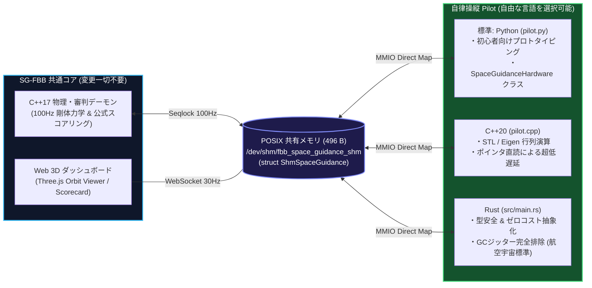

# Stage EX: パニックコントロール (Panic Control: Debris Collision & Emergency Recovery)

**難易度: Level 5 (Extra / 最難関) | 物理空間: 完全無重力・無摩擦 ＋ 3軸高速カオスタンブリング ＋ 12基スラスタ欠損連成力学 ＋ 3軸リアクションホイール**

---

## 1. ミッション概要 (Mission Overview)

未探査宇宙デブリ帯を航行中の自律探査機が、突如として漂流スペースデブリの激しい直撃を受けました。

デブリ衝突の巨大な衝撃力積により、探査機は **3軸（ロール・ピッチ・ヨー）にわたる毎秒140度超（$|\vec{\omega}_0| \approx 2.5\text{ rad/s}$）の激しい高速カオスタンブリング（スピン）** に陥り、さらに機体に搭載された **12基の 6-DoF RCS パルススラスタのうち、衝突点近傍のノズル（1〜2基）が物理的に破損・不発** となりました。加えて、推進剤配管の損傷により燃料が時間とともに自然流出（微小リーク）しています。

完全無摩擦の宇宙空間では、何もしなければ探査機は永遠に回転し続け、燃料を失って宇宙の藻屑と化します。プレイヤーはジョイスティックによる手動操作を一切使わず、**自律制御スクリプト（`pilot.py`）** のみを用いて以下の4フェーズのリカバリーを成し遂げなければなりません：



---

## 2. 機体仕様・12基 6-DoF RCS スラスタ配置 & 3軸リアクションホイール

探査機には、機体全周に対向配置された **12基の RCS パルススラスタ（$F_{\max} = 20.0\text{ N}$）** と、X/Y/Z 各軸の角運動量を電気駆動（燃料消費ゼロ）で吸収する **3軸リアクションホイール・クラスタ** が搭載されています。

```text
                  [水平面 (XY平面 / Z = 0)]
                        +Y (Port / 左舷)
                  [T4]                    [T5]
                   |                       |
               +---+-----------------------+---+
               |                               |
 [-X] [T2] ----|           CoM (0,0)           |---- [T0] [+X]
 Reverse       |    [ 3-Axis Reaction Wheels ] |    Forward
 [-X] [T3] ----|                               |---- [T1] [+X]
               |                               |
               +---+-----------------------+---+
                   |                       |
                  [T6]                    [T7]
                        -Y (Starboard / 右舷)

                  [垂直面 (XZ平面 / ピッチ制御)]
                        +Z (Dorsal / 背面)
              [T8: Fwd-Dorsal]    [T10: Aft-Dorsal]
                    |                    |
             +------+--------------------+------+
   Forward   |                                  |   Aft
   (+X)      |             CoM (0,0)            |   (-X)
             +------+--------------------+------+
                    |                    |
             [T9: Fwd-Ventral]   [T11: Aft-Ventral]
                        -Z (Ventral / 腹面)
```

### (1) 全12基スラスタの公称発生力・トルク特性

| ノズル番号 | 機体配置座標 $\vec{r}_i$ [m] | 噴射方向 $\vec{n}_i$ | 発生推力 $\vec{F}$ | 発生トルク $\vec{\tau}$ | 主な役割 |
| :---: | :---: | :---: | :---: | :---: | :---: |
| **T0** | $(-1.3, -1.0, 0.0)$ | $(+1, 0, 0)$ [前進] | $+20.0\text{ N}$ ($+X$) | $\tau_z = -20.0\text{ N}\cdot\text{m}$ (時計回り) | 前進推進 / ヨー右旋回 |
| **T1** | $(-1.3, +1.0, 0.0)$ | $(+1, 0, 0)$ [前進] | $+20.0\text{ N}$ ($+X$) | $\tau_z = +20.0\text{ N}\cdot\text{m}$ (反時計回り) | 前進推進 / ヨー左旋回 |
| **T2** | $(+1.0, -0.6, 0.0)$ | $(-1, 0, 0)$ [後進] | $-20.0\text{ N}$ ($-X$) | $\tau_z = +20.0\text{ N}\cdot\text{m}$ (反時計回り) | 後進制動 / ヨー左旋回 |
| **T3** | $(+1.0, +0.6, 0.0)$ | $(-1, 0, 0)$ [後進] | $-20.0\text{ N}$ ($-X$) | $\tau_z = -20.0\text{ N}\cdot\text{m}$ (時計回り) | 後進制動 / ヨー右旋回 |
| **T4** | $(-1.0, -1.8, 0.0)$ | $(0, +1, 0)$ [左舷] | $+20.0\text{ N}$ ($+Y$) | $\tau_z = -20.0\text{ N}\cdot\text{m}$ (時計回り) | 左舷横移動 / ヨー右旋回 |
| **T5** | $(+0.8, -0.65, 0.0)$| $(0, +1, 0)$ [左舷] | $+20.0\text{ N}$ ($+Y$) | $\tau_z = +20.0\text{ N}\cdot\text{m}$ (反時計回り) | 左舷横移動 / ヨー左旋回 |
| **T6** | $(-1.0, +1.8, 0.0)$ | $(0, -1, 0)$ [右舷] | $-20.0\text{ N}$ ($-Y$) | $\tau_z = +20.0\text{ N}\cdot\text{m}$ (反時計回り) | 右舷横移動 / ヨー左旋回 |
| **T7** | $(+0.8, +0.65, 0.0)$| $(0, -1, 0)$ [右舷] | $-20.0\text{ N}$ ($-Y$) | $\tau_z = -20.0\text{ N}\cdot\text{m}$ (時計回り) | 右舷横移動 / ヨー右旋回 |
| **T8** | $(+1.25, 0.0, +0.5)$| $(0, 0, +1)$ [背面] | $+20.0\text{ N}$ ($+Z$) | $\tau_y = -25.0\text{ N}\cdot\text{m}$ (ピッチダウン) | 垂直上昇 / ピッチ下げ |
| **T9** | $(+1.25, 0.0, -0.5)$| $(0, 0, -1)$ [腹面] | $-20.0\text{ N}$ ($-Z$) | $\tau_y = +25.0\text{ N}\cdot\text{m}$ (ピッチアップ) | 垂直降下 / ピッチ上げ |
| **T10**| $(-1.25, 0.0, +0.5)$| $(0, 0, +1)$ [背面] | $+20.0\text{ N}$ ($+Z$) | $\tau_y = +25.0\text{ N}\cdot\text{m}$ (ピッチアップ) | 垂直上昇 / ピッチ上げ |
| **T11**| $(-1.25, 0.0, -0.5)$| $(0, 0, -1)$ [腹面] | $-20.0\text{ N}$ ($-Z$) | $\tau_y = -25.0\text{ N}\cdot\text{m}$ (ピッチダウン) | 垂直降下 / ピッチ下げ |

### (2) 物理諸元 (Spacecraft Dynamics & Limits)

* **乾燥質量 ($M$)**: $100.0\text{ kg}$
* **主慣性モーメント**:
  * ロール軸慣性モーメント ($I_{xx}$): $15.0\text{ kg}\cdot\text{m}^2$
  * ピッチ軸慣性モーメント ($I_{yy}$): $20.0\text{ kg}\cdot\text{m}^2$
  * ヨー軸慣性モーメント ($I_{zz}$): $25.0\text{ kg}\cdot\text{m}^2$
* **3軸リアクションホイール・クラスタ**:
  * 各軸慣性モーメント ($I_w$): $0.05\text{ kg}\cdot\text{m}^2$
  * 許容限界回転数: $\pm 6,000\text{ RPM}$ (電気駆動・推進剤消費ゼロ)
* **推進剤自然リーク率**: $-0.15\text{ \%/s}$（放置すると約50秒で燃料枯渇失格）
* **安全脱出境界**: $X \ge 35.0\text{ m}$
  * **グリーン安全ゲート判定**: $|Y| \le 6.0\text{ m}$ かつ $|Z| \le 6.0\text{ m}$ の範囲内で脱出ラインを通過すると高額ボーナス獲得。

---

## 3. デブリ衝突力学 & カオスインジェクション (Procedural Chaos Injection)

本ステージでは、カオスシード（乱数シード）に基づき、**完全シミュレートされた 3D 衝突物理** が決定論的に生成されます：

```text
[カオスシード Seed (32-bit)]
          │
          ├──> 飛来方位角 Azimuth: -180° 〜 +180° (全天360度)
          ├──> 飛来仰角 Elevation: -30° 〜 +30°
          ├──> 機体表面衝突点 r_imp: (ix, iy, iz)
          ├──> 衝突速度ベクトル v_deb (~32 m/s)
          │      ├── 並進ドリフト積: ΔV = (m_deb / M) * v_deb
          │      └── 回転角運動量積: J = r_imp × P_deb
          │            └── 3軸初期タンブリング率: Δω = I^(-1) * J
          └──> 衝突点近接スラスタ判定 (最短ユークリッド距離の 1〜2 基が破損・機能停止)
```

### (1) シードの指定方法

* **公式ベースラインシード (`0x1337`)**:
  * Starboard-Aft（右舷後方斜め上）から飛来。
  * **T1（前進右）および T6（右舷後部）の2基が破損**。
  * CI 自動テストおよび基準性能測定で常に再現性 100% を保証します。
* **任意シード指定**:
  * CLI 引数 `--seed <HEX>` または環境変数 `FBB_CHAOS_SEED=<HEX>` で任意の飛来方向・衝突条件を指定可能。
  * 引数未指定時は起動毎に動的ランダムシードが自動採番され、全方向からの飛来・破損バリエーションをテストできます。

---

## 4. ハードウェア・レジスタマップ & 制御インターフェース

F-BB 共有メモリ `/tmp/fbb_space_guidance_shm`（実機では AMD Xilinx Zynq UIO デバイス `/dev/uio0`）を介して通信します。

### (1) コマンドレジスタマップ (Host -> Hardware)

| オフセット | レジスタ名 | 型 / 単位 | 説明 |
| :---: | :---: | :---: | :--- |
| `0x10` | `thrust_cmd_x` | Q16.16 [N] | 推進力 X コマンド（前進 / 後進） |
| `0x14` | `thrust_cmd_y` | Q16.16 [N] | 推進力 Y コマンド（ポート / スターボード横移動） |
| `0x18` | `thrust_cmd_z` | `uint32` (Bitmask) | **ノズル直接パルス噴射マスク**（Bit $0 \sim 11$ が T0〜T11 に対応） |
| `0x1C` | `torque_cmd` | Q16.16 [$\text{N}\cdot\text{m}$] | RCS ヨー軸トルク指令 |
| `0x24` | `watchdog_kick`| `uint32` | ウォッチドッグタイマ生存キック（周期的に 1 をライト） |
| `0x28` | `chaos_fault_inj` | `uint32` | カオスインジェクション・シードレジスタ |
| `0x2C` | `wheel_torque_cmd` | Q16.16 [$\text{N}\cdot\text{m}$] | リアクションホイール Z軸（ヨー制動）トルク指令 |
| `0x78` | `fdir_mode` | `uint32` | FDIR 状態通知（0: Panic, 1: Detumble, 2: SysID, 3: Escape） |
| `0x90` | `torque_x` | Q16.16 [$\text{N}\cdot\text{m}$] | 拡張 6-DoF: RCS ロールトルク指令 |
| `0x94` | `torque_y` | Q16.16 [$\text{N}\cdot\text{m}$] | 拡張 6-DoF: RCS ピッチトルク指令 |
| `0x98` | `wheel_torque_x` | Q16.16 [$\text{N}\cdot\text{m}$] | 拡張 6-DoF: リアクションホイール X軸（ロール制動）トルク指令 |
| `0x9C` | `wheel_torque_y` | Q16.16 [$\text{N}\cdot\text{m}$] | 拡張 6-DoF: リアクションホイール Y軸（ピッチ制動）トルク指令 |
| `0xA0` | `thrust_vertical`| Q16.16 [N] | 拡張 6-DoF: 垂直推力 Z コマンド |

### (2) Python 制御 API (`SpaceGuidanceHardware`)

`pilot.py` から標準提供されている高水準 API を呼び出して制御します：

```python
hw = SpaceGuidanceHardware()

# 1. テレメトリ取得 (3D姿勢・角速度・ホイール回転数・健全性マスク含む)
tlm = hw.read_registers()
# tlm["pos_x"], tlm["pos_y"], tlm["pos_z"]
# tlm["roll"], tlm["pitch"], tlm["yaw"]
# tlm["omega_x"], tlm["omega_y"], tlm["omega_z"]
# tlm["wheel_rpm_x"], tlm["wheel_rpm_y"], tlm["wheel_rpm_z"]
# tlm["thruster_health"] (0x0FFF: 全12基正常)

# 2. 3軸リアクションホイール専用指令 (推進剤消費ゼロ)
hw.write_reaction_wheel(wheel_torque_z, wheel_torque_x=0.0, wheel_torque_y=0.0)

# 3. ノズル単発マイクロパルス噴射 (SysID用)
hw.write_thruster_pulse(1 << nozzle_id)

# 4. 複合制御コマンド書き込み
hw.write_commands(
    thrust_x=0.0, thrust_y=0.0, torque=rcs_torque_z,
    wheel_torque=wheel_torque_z, fdir_mode=3,
    thrust_z=active_burn_mask, # 生存ノズルマスク
    wheel_torque_x=wheel_cmd_x, wheel_torque_y=wheel_cmd_y
)

# 5. ウォッチドッグ更新
hw.kick_watchdog()
```

---

## 5. 攻略手順：自律復旧 4大フェーズ (Recovery Sequence Walkthrough)

### Phase 0: 衝突緊急事態検知 & プロローグ観察 (T = 0 〜 4.5s)
衝突直後は巨大な衝撃力積により 3軸タンブリングが発生しています。
* 最初の 4.5 秒間は機体のセンサ値（$\omega_x, \omega_y, \omega_z$）をサンプリングし、回転レートを正確に把握します。
* この間、Orbit Viewer 上では衝突ショックウェーブ、破片火花、ノズル破損を示す赤色ブラケット、燃料蒸気のリーク軌跡が可視化されます。

### Phase 1: 3D緊急デタンブル (Rate Damping & 3-Axis RW)
* **3軸リアクションホイール最大トルク制動**:
  各軸の角速度と逆向きに最大トルクを印加し、角運動量をホイールに逃がします（**燃料消費 0%**）。
* **RCS レートダンピング逆噴射**:
  残留スピンに対して逆トルク噴射を行い、**全軸の角速度ノルム $|\vec{\omega}| < 0.05\text{ rad/s}$** を 0.5 秒以上維持することでデタンブル完了マイルストーンを達成します。

### Phase 2: 12チャンネル・オンライン・システム同定 (Online SysID)
静止後、全12基のスラスタを順次 30ms 程度微小パルス噴射（`hw.write_thruster_pulse(1 << i)`）し、IMU の角加速度応答 $\Delta \vec{\omega}$ を計測します：
* 健全ノズル: 明確な回転応答（$|\Delta \vec{\omega}| > 0.012\text{ rad/s}$）が観測される。
* 破損ノズル: **応答ゼロ**。
* 健全と確認できたノズル番号を「生存ノズルセット」として記録します。

### Phase 3: 制御配分 & 6自由度安全圏脱出 (Control Allocation & Escape)
生存ノズルのみを組み合わせて「不要な回転トルクを相殺しつつ $+X$ 前進加速を得る」推力配分を計算します：
* **姿勢アライメント**: 3軸リアクションホイールでロール・ピッチを常にゼロ位ロックしつつ、ヨー姿勢を目標方向に保持。
* **視線誘導 (Line-of-Sight Guidance)**: 脱出ライン通過時にグリーン安全ゲート（$|Y| \le 6.0\text{m}, |Z| \le 6.0\text{m}$）の中心へ向かうよう横方向ドリフトを補正。
* **二次デブリ回避**: 浮遊する周囲のデブリ（半径 1.5m 判定）との再衝突を回避しながら $X \ge 35.0\text{m}$ へ脱出します。

---

## 6. 採点基準 & 公式審判システム (Official Referee SSOT)

物理デーモン内の `OfficialReferee` エンジンが 100Hz 周期でオーソリテーティブに判定します：

$$\text{Final Score} = \text{Checkpoint Score} + \text{Bonus Score}$$

### (1) チェックポイント得点 (Checkpoint Score: 最大 4,000 pts)

| マイルストーン | 判定条件 | 配点 | 備考 |
| :--- | :--- | :---: | :--- |
| **Check 1: デタンブル達成** | $\|\vec{\omega}\| < 0.05\text{ rad/s}$ を 0.5 秒保持 | **最大 $+3,000\text{ pts}$** | $\max(0, (15.0\text{s} - T_{\text{detumble}}) \times 200)$ |
| **Check 2: 巡航ウェイポイント** | 安定姿勢で $X \ge 15.0\text{m}$ 通過 | **$+1,000\text{ pts}$** | SysID 完了および安定加速の確認 |

### (2) ボーナス得点 (Bonus Score: 最大 7,500 pts)

| 評価項目 | 判定条件 | 配点 | 備考 |
| :--- | :--- | :---: | :--- |
| **脱出成功基本点** | 安全境界 $X \ge 35.0\text{m}$ 到達 | **$+1,000\text{ pts}$** | ベースクリア |
| **安全ゲート中心精度ボーナス** | 脱出時の中心軸距離 $r = \sqrt{Y^2 + Z^2}$ | **最大 $+2,500\text{ pts}$** | $r \le 1.0\text{m}$ (BULLSEYE): +2500<br>$r \le 2.5\text{m}$ (EXCELLENT): +1800<br>$r \le 4.5\text{m}$ (GOOD): +1200<br>$r \le 7.0\text{m}$ (MARGINAL): +500 |
| **推進剤残量ボーナス** | 残燃料 $(\%) \times 25.0$ | **最大 $+2,500\text{ pts}$** | RW 併用・無駄なキャンセル噴射削減で高得点 |
| **デブリ回避ボーナス** | 浮遊デブリへの再接触回数 | **最大 $+1,500\text{ pts}$** | 0回: +1500点, 1〜2回: +500点, 3回以上: 0点 |

> **理論最大得点: $11,000\text{ pts}$**

### (3) フライトランク認定基準

* 🏆 **GRADE S (Elite Astronaut)**: **8,000 pts 以上**（超高速デタンブル、残燃料70%以上、安全ゲート中央通過、デブリ完全回避）
* 🥇 **GRADE A (Certified)**: 6,500 〜 7,999 pts
* 🥈 **GRADE B (Standard)**: 5,000 〜 6,499 pts
* 🥉 **GRADE C (Pass)**: 5,000 pts 未満
* 💀 **FAILED**: 推進剤枯渇（燃料 0% 到達）または脱出不能

---

## 7. 実行方法 & CLI オプション (Execution & Options)

### (1) Web 3D 統合ラボ (F-BB 統合環境)

```bash
# F-BB 統合ラボを起動 (ブラウザで http://localhost:8080 を開く)
./start_lab.sh /workspaces/SpaceGuidance-FBB/scenario/05_panic_control
```

* **Orbit Viewer**:
  * 3D チェイスカメラで宇宙船を追従。
  * デブリ飛来角・方位角 HUD 表示 (`SEED: 0xXXXX`, `INC: BOW/PORT/STBD/STERN (AZ°)`).
  * 破損ノズルの赤色ブラケット強調 & 推進剤白煙リークエフェクト。
  * 目標グリーン安全ゲートリング ($X = 35.0\text{m}, R = 6.0\text{m}$).
* **Chaos FDIR コンソール**:
  * リアルタイム角速度グラフ、12基スラスタの健全性ステータスマトリクス、審判スコアボードを表示。

### (2) CLI スタンドアロン実行

```bash
# 1. デフォルト実行 (起動毎に動的ランダムシードが生成されるモード)
bash scenario/05_panic_control/run.sh

# 2. 公式ベースラインシード (0x1337) で決定論的テスト (T1 & T6 破損)
bash scenario/05_panic_control/run.sh --seed 0x1337

# 3. 任意のカオスシードで未知の衝突方向・破損パターンをストレステスト
bash scenario/05_panic_control/run.sh --seed 0xCAFE

# 4. ヘッドレス・高速ミッション実行スクリプト
bash scenario/05_panic_control/run_mission.sh --seed 0x1337
```

---

## 8. 発展課題：他言語 (C++ / Rust) による自律操縦チャレンジ (Multi-Language Flight Software Challenge)

本プラグインでは標準の自律制御スクリプトとして Python（`pilot.py`）を提供していますが、**SG-FBB の本体エンジン（物理デーモン、公式審判 SSOT、Three.js 3D ダッシュボード）側には一切変更を加えることなく、C++ や Rust などのコンパイル言語で自作 pilot を開発して挑むことが可能**です。

これは、宇宙航空分野で実際に求められる **「GC（ガベージコレクション）によるジッターのない、マイクロ秒精度の高信頼性フライトソフトウェア（FSW）」** の開発体験をそのまま実践できる設計となっています。

### (1) なぜ本体無変更で他言語対応できるのか？（疎結合 ABI アーキテクチャ）

SG-FBB の通信基盤は、特定言語の RPC やフレームワークに依存せず、**OS の POSIX 共有メモリ（`/dev/shm/fbb_space_guidance_shm`）上に配置された 496 バイトの C 構造体（`ShmSpaceGuidance`）** のみを共通規格（ABI）としています。



---

### (2) 共有メモリ仕様 (C 構造体インターフェース)

パイロット側は、プロジェクト共通ヘッダー [include/space_guidance_shm.h](include/space_guidance_shm.h) の `struct ShmSpaceGuidance` をメモリマップするだけで、全テレメトリの取得と推力指令の書き込みが完了します。

* **初動トリガー (ADR #002)**: `cr_ctrl |= 0x08` を書き込んだ瞬間、公式タイマーが自動始動します。
* **テレメトリ直読 (8バイト浮動小数点)**: `ext.omega_x`, `ext.omega_y`, `ext.omega_z`, `pos_x`, `vel_x`, `fuel` など
* **制御コマンド直書 (Q16.16 固定小数点 / 整数)**: `torque_x_cmd`, `torque_y_cmd`, `torque_cmd`, `wheel_torque_x_cmd`, `thrust_cmd_x` など

---

### (3) C++ による Pilot 実装案

C++ では、標準の POSIX `mmap` を用いてポインタを取得するだけで、最小限のオーバーヘッドで 100Hz 制御ループを構築できます。

```cpp
// pilot.cpp
#include "../../include/space_guidance_shm.h"
#include <fcntl.h>
#include <sys/mman.h>
#include <unistd.h>
#include <iostream>
#include <cmath>

int main() {
    int fd = open(SPACE_GUIDANCE_SHM_PATH, O_RDWR);
    if (fd < 0) {
        std::cerr << "Failed to open shared memory: " << SPACE_GUIDANCE_SHM_PATH << std::endl;
        return 1;
    }
    auto* regs = static_cast<volatile ShmSpaceGuidance*>(
        mmap(nullptr, 4096, PROT_READ | PROT_WRITE, MAP_SHARED, fd, 0));

    // 1. 初動トリガー送信 (公式審判タイマー始動)
    regs->cr_ctrl |= 0x08;
    std::cout << "[C++ Pilot] Mission Engaged! Starting Rate Damping..." << std::endl;

    // 2. 100Hz 制御ループ
    while (regs->pos_x < 35.0 && regs->fuel > 0.0) {
        regs->watchdog_kick = 1; // WDT クリア

        // 3軸角速度の直読
        double wx = regs->ext.omega_x;
        double wy = regs->ext.omega_y;
        double wz = regs->ext.omega_z;

        // レートダンピング指令 (PD逆トルク / Q16.16)
        regs->torque_x_cmd = static_cast<int32_t>(-wx * 0.85 * 65536.0);
        regs->torque_y_cmd = static_cast<int32_t>(-wy * 0.85 * 65536.0);
        regs->torque_cmd   = static_cast<int32_t>(-wz * 0.85 * 65536.0);

        usleep(10000); // 10ms (100Hz)
    }

    std::cout << "[C++ Pilot] Safe orbit reached or mission ended." << std::endl;
    munmap(const_cast<ShmSpaceGuidance*>(regs), 4096);
    close(fd);
    return 0;
}
```

> **ビルド方法 (Makefile / CMake)**:
> ```bash
> g++ -O3 -std=c++17 pilot.cpp -lpthread -o pilot_cpp
> ```

---

### (4) Rust による Pilot 実装案

Rust では、`memmap2` クレートを用いて共有メモリを安全にラップすることで、宇宙機フライトソフトウェアに不可欠な **メモリ安全性** と **GCレスの決定論的リアルタイム性能** を両立できます。

```toml
# Cargo.toml
[package]
name = "panic_pilot_rust"
version = "0.1.0"
edition = "2021"

[dependencies]
memmap2 = "0.9"
```

```rust
// src/main.rs
use std::fs::OpenOptions;
use std::thread::sleep;
use std::time::Duration;
use memmap2::MmapMut;

// C言語構造体のアライメント整合
#[repr(C, packed(4))]
struct PilotBridge {
    cr_ctrl: u32,
    _pad1: [u8; 12],
    thrust_cmd_x: u32,
    _pad2: [u8; 8],
    torque_cmd: u32,
    _pad3: [u8; 4],
    watchdog_kick: u32,
    _pad4: [u8; 8],
    pos_x: f64,
    // (必要に応じて include/space_guidance_shm.h と一致させる)
}

fn main() -> Result<(), Box<dyn std::error::Error>> {
    let file = OpenOptions::new()
        .read(true)
        .write(true)
        .open("/dev/shm/fbb_space_guidance_shm")?;

    let mut mmap = unsafe { MmapMut::map_mut(&file)? };
    let bridge = unsafe { &mut *(mmap.as_mut_ptr() as *mut PilotBridge) };

    // 公式タイマー始動
    bridge.cr_ctrl |= 0x08;
    println!("[Rust Pilot] Autonomous Mission Started (Zero-GC Realtime).");

    loop {
        bridge.watchdog_kick = 1;
        if bridge.pos_x >= 35.0 {
            println!("[Rust Pilot] Safe corridor escaped successfully!");
            break;
        }
        sleep(Duration::from_millis(10));
    }
    Ok(())
}
```

> **ビルド方法**:
> ```bash
> cargo build --release
> ```

---

### (5) 起動スクリプト（`run.sh`）のハイブリッド自動認識化

[run.sh](scenario/05_panic_control/run.sh) のパイロット起動部を以下のように拡張することで、**「コンパイル済みバイナリ（C++ / Rust）が存在すれば優先起動し、無ければ標準の Python スクリプトを実行する」** という完全透過な運用が可能です：

```bash
# バイナリ優先起動ロジックの例
if [ -x "$SCRIPT_DIR/pilot_cpp" ]; then
    echo "[SpaceGuidance] Executing High-Performance C++ Pilot..."
    "$SCRIPT_DIR/pilot_cpp" "$@"
elif [ -x "$SCRIPT_DIR/target/release/panic_pilot_rust" ]; then
    echo "[SpaceGuidance] Executing High-Assurance Rust Pilot..."
    "$SCRIPT_DIR/target/release/panic_pilot_rust" "$@"
else
    echo "[SpaceGuidance] Executing Baseline Python Autopilot..."
    python3 "$PILOT_SCRIPT" "$@"
fi
```

このように、受講生やチャレンジャーは **「アルゴリズム先行で素早く試す Python」** から、**「実機宇宙機FSWを見据えた C++ / Rust による極限の制御周期・低遅延化」** へと、同一ステージ・同一レギュレーションのままシームレスにステップアップできます。

